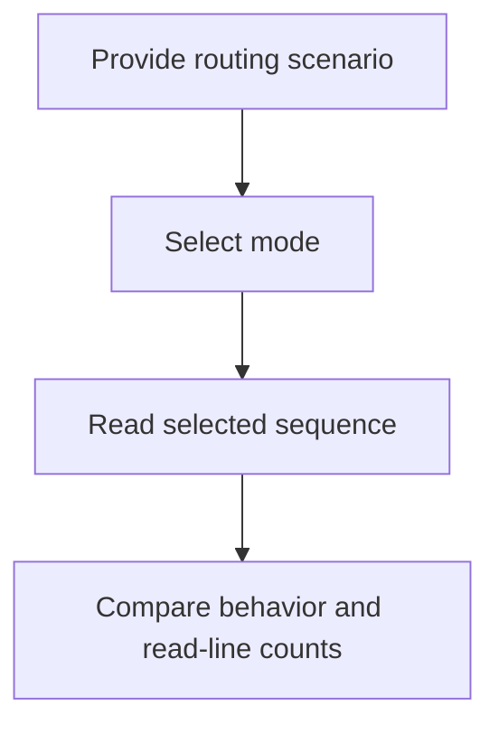
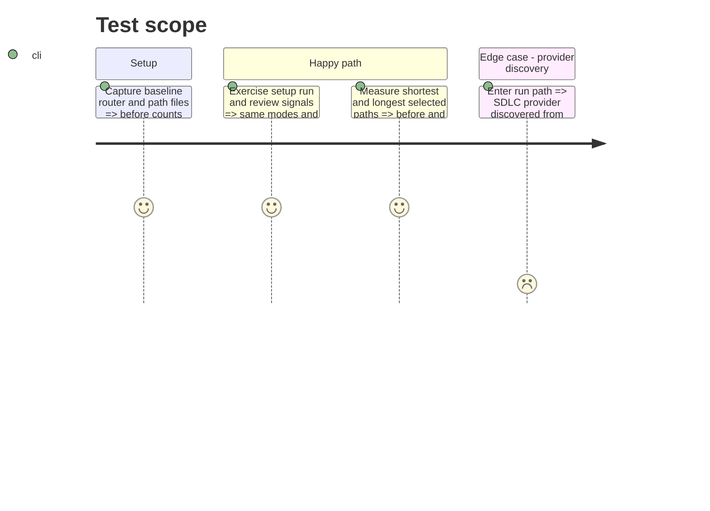

# Instruction: Prove compatibility and reading cost

## Architecture projection

> Tree of the final files. ✅ create · ✏️ modify · ❌ delete

```txt
scripts/__tests__/
└── ✅ async-dev-router.test.js  # routing and lazy-load regressions
aidd_docs/tasks/2026_10/2026_10_20_delivery-loop-router/
└── ✅ evidence.md               # shortest and longest path line counts
```

## User Journey



## Test Scope



## Tasks to do

### `1)` Guard observable routing

> Verify mode selection, action order, and exclusions without changing automation policy.

1. Test explicit arguments, CI labels and comment aliases, repo state, natural language, tie breaks, conflicts, and unresolved signals.
2. Assert only the selected mode sequence loads; retain dynamic provider discovery in the existing run actions.

### `2)` Record reading cost

> Supply reproducible before and after line totals for the PR.

1. Count lines read on shortest and longest paths with a documented inclusion rule and the pre-change revision.
2. Record commands and counts in `evidence.md`; carry totals to PR description.
3. Run architecture checks and relevant repository test gate.

## Test acceptance criteria

| Task | Acceptance criteria |
| --- | --- |
| 1 | Setup, run, and review route and execute their existing ordered action sequences for the same inputs; aliases and conflicts retain behavior. |
| 2 | Before and after shortest and longest path line counts are reproducible and available for the PR; repository checks pass. |
