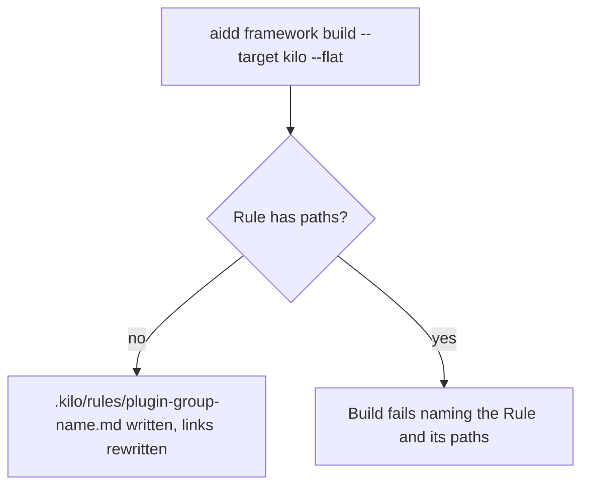
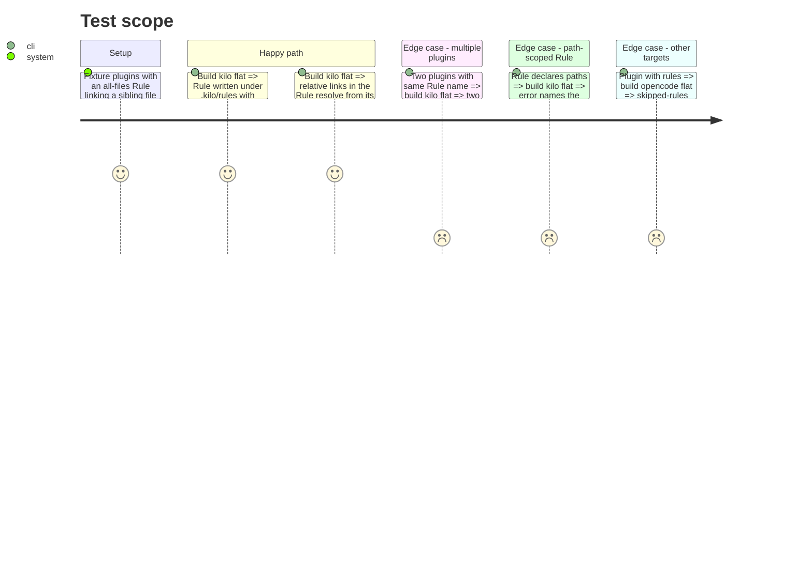

# Instruction: Flat Rule emission for Kilo

## Architecture projection
> Tree of the final files. ✅ create · ✏️ modify · ❌ delete

```txt
cli/
├── src/
│   ├── kernel/errors.ts                                              ✏️ add a path-scoped-Rule error naming Rule and scope
│   ├── kernel/materialization/flat-paths.ts                          ✏️ add genericFlatRulePath(prefix, plugin, rel)
│   ├── contexts/tools/domain/profiles/kilo/build.ts                  ✏️ rules: supported, path, transform rejecting `paths`, link rewrite
│   ├── contexts/translate/application/strategies/build-output-strategy.ts   ✏️ add writeRules
│   ├── contexts/translate/application/strategies/flat-build-strategy.ts     ✏️ implement writeRules (collision check, transform, link rewrite)
│   ├── contexts/translate/application/strategies/marketplace-build-strategy.ts ✏️ writeRules returns 0
│   └── contexts/translate/application/translate-source.ts            ✏️ call writeRules; warn only for unsupported sections
└── tests/
    ├── contexts/tools/domain/profiles/kilo/build.unit.test.ts        ✏️ rule path, transform, rejection
    └── contexts/translate/application/strategies/flat-build-strategy*.test.ts ✏️ rule writing, multiple plugins, link rewrite
```

## User Journey


## Test Scope


## Tasks to do
### `1)` Rule path and error
> Deterministic, collision-free flat Rule path and a named error.

1. Add `genericFlatRulePath` in `flat-paths.ts`: `${prefix}${plugin}-${rel without rules/, "/" → "-"}`.
2. Add a domain error in `kernel/errors.ts` carrying Rule path and its `paths` values.

### `2)` Kilo rules contract
> Kilo declares rules as supported.

1. In `buildKiloFlatContract()`, set `rules` to `filteredTree` over `rules`, `.md`, path `.kilo/rules/…`.
2. Transform: parse frontmatter, throw the new error when `paths` is present, rewrite relative links for the materialized location, keep content otherwise.

### `3)` Generic flat writer
> The flat strategy writes rules when the contract supports them.

1. Add `writeRules` to `BuildOutputStrategy`; marketplace returns 0.
2. Implement in `FlatBuildStrategy` mirroring `writeAgents` (collision check, `force`).
3. Call it in `translate-source.ts`; skip the out-of-scope warning for a section the contract supports.

### `4)` Tests
> Cover the scope above at unit level.

1. Extend Kilo build unit tests and flat strategy tests per Test Scope.

## Test acceptance criteria
| Task | Acceptance criteria |
| --- | --- |
| 1 | `genericFlatRulePath(".kilo/rules/", "aidd-test", "rules/01-standards/naming.md")` returns `.kilo/rules/aidd-test-01-standards-naming.md`. |
| 2 | A Rule with `paths` makes the build fail with a message naming the Rule and its paths; no file is written for it. |
| 3 | An all-files Rule is emitted under `.kilo/rules/`; relative links in it resolve; other flat targets still warn and skip rules. |
| 4 | `pnpm --filter ./cli test` (or the repo's test command) passes. |
