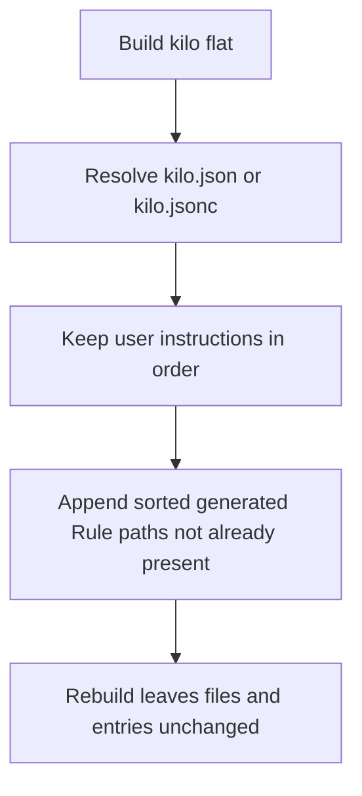
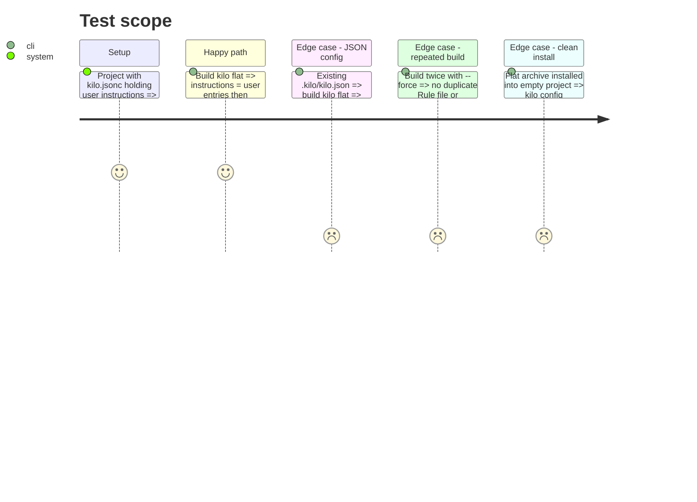

# Instruction: Kilo `instructions` merge and installed-archive proof

## Architecture projection
> Tree of the final files. ✅ create · ✏️ modify · ❌ delete

```txt
cli/
├── src/contexts/tools/domain/profiles/kilo/build.ts                  ✏️ emitConfigArtifact appends generated Rule paths to instructions
├── tests/contexts/tools/domain/profiles/kilo/build.unit.test.ts      ✏️ JSON, JSONC, existing instructions, repeat build
├── tests/e2e/framework-build.e2e.test.ts                             ✏️ kilo flat build ships rules + instructions
└── tests/golden/snapshots/framework-build/golden.json                ✏️ only if the golden captures kilo output
```

## User Journey


## Test Scope


## Tasks to do
### `1)` Merge generated instructions
> The resolved Kilo config references every emitted Rule.

1. In `emitConfigArtifact`, list each built plugin's `.md` Rules, map them with the Phase 1 path, sort.
2. Pass them as base `instructions` with `mergedKeys: ["instructions"]` to `buildOpencodeFlatConfig`.

### `2)` Installed-archive proof
> A clean install keeps the generated instructions.

1. Check that installing a flat Kilo archive into a clean project keeps `instructions` (`install-runtime-config-use-case.ts` rewrites the config); fix if it drops them.
2. Extend the kilo flat e2e in `framework-build.e2e.test.ts`.
3. Run `tests/e2e/kilo-runtime.e2e.test.ts` when a Kilo binary is available; otherwise report it as not run.

## Test acceptance criteria
| Task | Acceptance criteria |
| --- | --- |
| 1 | User `instructions` keep values and order; generated paths follow them, sorted; a rebuild changes nothing. |
| 2 | A clean installed archive has a Kilo config whose `instructions` include each emitted Rule; the Kilo runtime check is run or reported as not runnable. |
