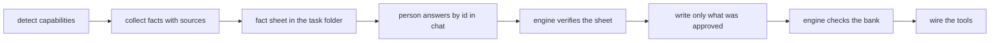

# Design: Project memory, built like a person would build it

## Reader

The memory is the macro view of the project that an AI tool loads at the start of every session, so it does not search for context it should already have. A person reads it too. Every line must answer a question that reader has, and must be true.

What that reader needs, in three parts:

| Part | Questions |
| --- | --- |
| Functional | what the project is, for whom, why; who uses it; the main journey from a request to a result; the domain words; the business rules that never bend; what it deliberately does not do |
| Technical | the stack and why; how the pieces fit; where things live; where execution starts; the decisions behind the shape; the services outside the repository; how it ships |
| Conventions of the project | where new code goes and what may import what; branches, commits, pull requests; where tests go and which command runs them; the checks that must pass; what an agent may do alone |

## What goes wrong today

| Gap | Effect |
| --- | --- |
| The skill never states who reads the memory and why | the model has no measure of what to keep or how deep to go |
| No step collects facts before writing: the scan lists capabilities, the write fills templates from memory | invented specifics, the baseline's main error |
| No source per fact | nothing to verify, for the engine or the person |
| A refresh reviews the whole bank in one sweep | about one injected drift in three is caught |
| The reading stops at the first source that answers | a README ends the reading before the file that defines the convention |
| The check action may offer to remove a file whose capability the scan missed | detection varies between runs, so a team's file can be offered for removal |
| Nothing measures what every session loads | the largest token cost is untracked |
| The functional view is one table of features | the reader knows how the project is built, not what it does |

## Flow

One flow, three scopes. From scratch, with no code yet, belongs to `01-bootstrap`.

| Scope | When | What is read |
| --- | --- | --- |
| Create | no bank yet | the repository, driven by the questions of the selected templates |
| Update | a bank exists | what changed since the last commit that touched `aidd_docs/memory/`, and the memory lines those changes touch |
| Audit | the person asks for a full review | the whole bank against the repository |



For an update, `collect` starts from the change set, which the engine computes; the model runs no version-control command of its own. The engine prints the base and why it chose it, the changed files including uncommitted ones, the memory lines that cite a changed path, and the files whose capability a changed defining file belongs to. The model reviews those lines first, then the rest only mechanically.

| Case | Base |
| --- | --- |
| The bank has a commit | the last commit that touched `aidd_docs/memory/` |
| No repository, a bank never committed, or a base missing from a partial history | none: the scope becomes an audit, and the sheet says why |
| The person names a reference | that reference |

The sheet's header shows the base and its commit message, so a base that was only a small manual edit is visible and the person can name an older one. No fingerprint file is kept: it would conflict between branches, go stale when someone edits the bank by hand, and the shown base already covers its one gain.

## Fact sheet

Written by the skill, never by the person, at `aidd_docs/tasks/<month>/<date>_memory-<scope>/facts.md`. The person reads it in the editor and answers in chat by id. Nothing of it is loaded in later sessions.

| Block | Holds | The person |
| --- | --- | --- |
| Read `R1…` | a fact taken from the file that defines it: a branch, a gate command, a commit rule | reads if they wish |
| Inferred `D1…` | a fact deduced from code: a dependency direction, a placement, a journey | fixes what is wrong |
| Unknown `Q1…` | what the code cannot say: why, out of scope, business rules. At most eight, the most useful first | answers what they know |
| To rule | a detailed coding convention no existing rule covers | may run the rule skill; never written to memory |

The template slots are questions to the model, not to the person: the model answers each from the repository, and only what the code cannot say becomes a `Q` line. Each line names its memory file and section, the fact, and its source path. An update also lists, as `D` lines, every line it would change or remove.

One rule decides what is written: silence is consent, except for a removal.

| Line | Without an answer |
| --- | --- |
| `R`, `D` | written as proposed |
| `Q` | its slot is removed; nothing is invented |
| `D` that removes or replaces a team's line | not applied; it needs an explicit yes |

Interactive, the default: the sheet is shown once, the person answers in chat by id (`ok`, `D2: no invite step`, `Q1: no payments`), then the bank is written. A host question tool asks the `Q` lines when the host has one. Autonomous: no stop, the same rule; the sheet stays in the task folder for a later read. Before any write, the engine checks that every cited source exists; a failure is shown and nothing is written. The sheet is a file, so a cut session resumes from it.

The sheet's shape is an asset, `assets/fact-sheet.md`, with one line grammar the engine parses and nothing else:

```text
- <id> | <memory file> > <section> | <fact> | <source path> | <answer>
```

A skipped `Q` removes its slot, or its section when the section is left empty, so no unfilled slot reaches the bank.

## Memory and rules

Rules are written to `aidd_docs/rules/` and published to each tool's rule folder, which the tool loads by itself, sometimes only for matching files.

| Home | Holds |
| --- | --- |
| Memory, one line | a convention about how the project is organised or run: placement, import direction, branches, commits, test location, gates |
| Rule | a detailed convention for writing one kind of file: error handling, logging, naming inside a layer |

Before writing a convention line, the skill looks for an existing rule that covers it, in the places the rule skill's discovery reference lists: the canonical rule folder, each tool's own rule folder, the instruction files. No second list is kept here. Covered: nothing is written. Detailed and uncovered: it goes to the sheet's "To rule" block. Dropped after measurement: the rule skill was not reachable and restatements came anyway.

## Templates

The templates stay the norm. Additions go to `project-brief.md`, the home of the functional macro and the why:

| Section | Holds | Not the same as |
| --- | --- | --- |
| `Users` | the roles that exist, one line each | `auth.md`, which says how access is decided |
| `Main journey` | three to six steps from a request to a result | `Key features`, a list with entry points; `architecture.md` Flow, which draws processes |
| `Business rules` | the rules that never bend | `database.md`, which says how a rule is enforced |

No new file, no new conventions section. Create asks for the three sections; an update never forces them into an existing bank, only an audit proposes them.

## Budget

The engine reports the words every session loads: the always-loaded files plus the capability files present. Like the 400-word limit per file (M6), it is a warning, never a blocker.

## Phases

| # | Phase | Replaces |
| --- | --- | --- |
| 1 | Each memory file is named by what it holds | done |
| 2 | Facts are collected into a sheet, silence is consent except for a removal, the engine checks the sources before any write | the former phase 2: removals become `D` lines |
| 3 | A fact comes from the file that defines it, read by category, never by tool | the former phase 3: feeds the `R` block |
| 4 | An update starts from the change set since the last memory commit | the one-sweep review |
| 5 | The brief's three sections, the memory and rules boundary, the budget warning | none |

Each phase keeps the plan's rules: test first, one mutation per rule, real repositories first, one commit per phase.

## Measurement

Old and new skill, the same day, the same three real repositories, Haiku and Qwen, three runs each, cost included.

| Case | Measure | Today |
| --- | --- | --- |
| Update with four injected drifts | drifts caught, out of twelve | four to five |
| Update | team lines dropped without approval | zero, must stay zero |
| Create, two repositories | facts not true against the code, counted by a grader that is not the author | to measure |
| Create | `Q` lines asked, at most eight; `D` lines a grader finds wrong | to measure, lower is better |
| Every case | words loaded per session, cost, time | to measure |

Precondition for the update case: the refresh repository must carry the memory commit before the drift commits, as a real project does. The harness today makes one flat commit, so the change set would be empty; it gains a second commit for the drifts before phase 4 is measured.

Estimated spend: about 1 USD per phase, then about 5 to 6 USD for the final graded comparison.
