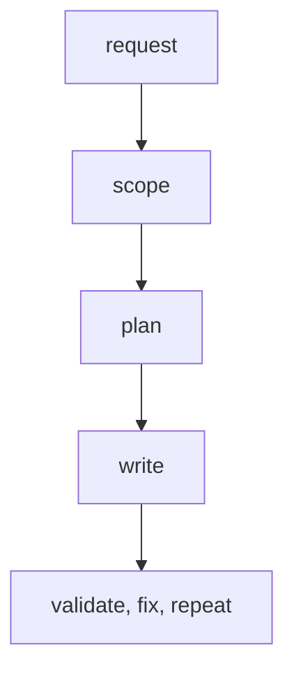
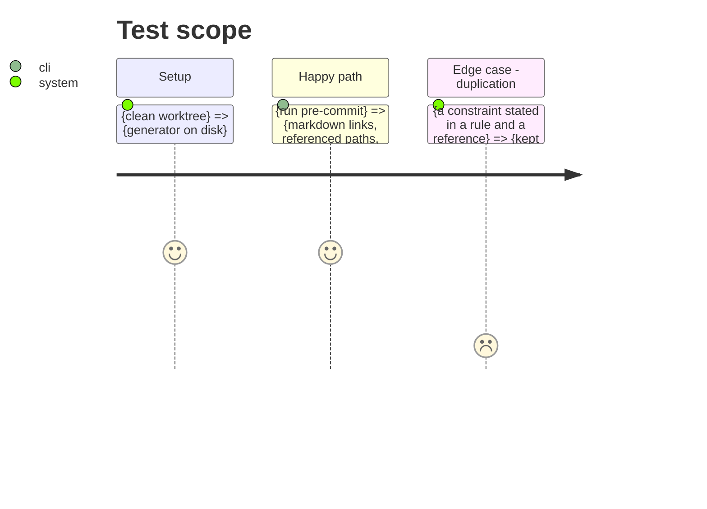

# Instruction: rewrite the generator to the lean format

## Architecture projection

```txt
plugins/aidd-context/skills/04-skill-generate/
├── SKILL.md                         ✏️ description one sentence, 150 chars target
├── actions/01-scope.md … 04-validate.md  ✏️ lean shape, last Process step reads next
├── assets/action-template.md        ✏️ no Test, no Done when
├── assets/skill-template.md         ✏️ flowchart LR, one node per action file
├── references/skill-authoring.md    ✏️ constraints only; R3 description rule, 100-line cap, risk step optional
├── references/fill-norm.md          ✅ per file kind, four placement questions
├── references/tool-write.md         ✏️ drop dated source lines
└── references/runtime-validation.md ✏️ optional trial, kept under 100 lines
```

## User Journey



## Test Scope



## Tasks to do

### `1)` Rewrite authoring contract and templates

> One home per fact: constraints in rules, judgment in references, diagram lists nodes.

1. Update `skill-authoring.md` to the brief's format, description target and 100-line cap.
2. Add `fill-norm.md` with the four placement questions per file kind.
3. Update both templates; remove every `## Test` or Done when slot.

### `2)` Rewrite the four actions

> Each action in lean shape, loop and risk step as Process steps.

1. Make `04-validate` a "validate, fix, repeat until it passes" step linking the check.
2. Offer the risk step (`disable-model-invocation`, `hooks`) in `02-plan`, never force it.
3. Strip dates from `tool-write.md`, per the no-dates rule.

## Test acceptance criteria

| Task | Acceptance criteria |
| ---- | ------------------- |
| 1 | No `## Test` or Done when in any template; each fact has one home |
| 2 | Every action and reference is under 100 lines; the diagram has one node per action file |
