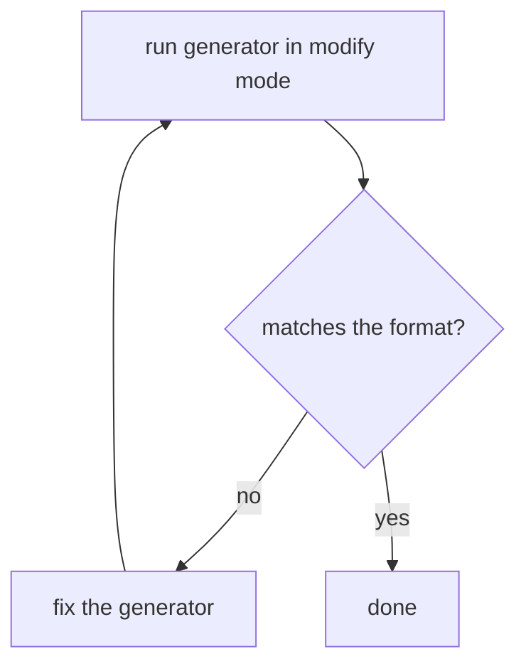
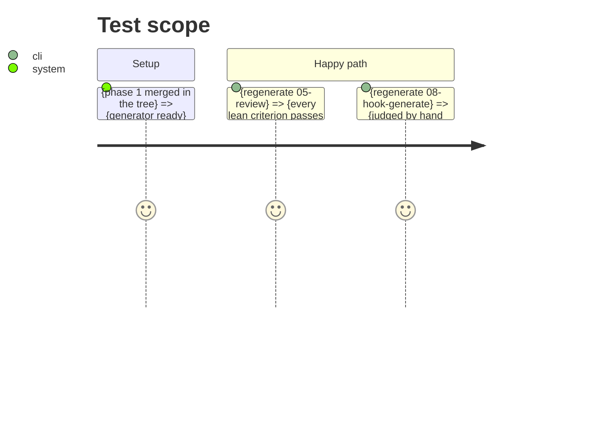

# Instruction: regenerate 05-review and 08-hook-generate

## Architecture projection

```txt
plugins/aidd-dev/skills/05-review/          ✏️ regenerated through the generator
plugins/aidd-context/skills/08-hook-generate/ ✏️ regenerated: diagram, no Test, no actions table
```

## User Journey



## Test Scope



## Tasks to do

### `1)` Regenerate 05-review

> Measured: it must already satisfy the format, so the run proves the generator.

1. Run modify; diff against the current tree; fix the generator on mismatch.

### `2)` Regenerate 08-hook-generate

> It carries the old format: actions table, `## Test`, "run each action's `## Test`".

1. Run modify; replace the table with a flowchart; remove every `## Test`.
2. Do not apply the framework hook contract to the hooks it generates.

## Test acceptance criteria

| Task | Acceptance criteria |
| ---- | ------------------- |
| 1 | Diagram nodes equal action files; no Test section; actions under 100 lines |
| 2 | Same, plus a reviewer finds no behavior lost from the old version |
