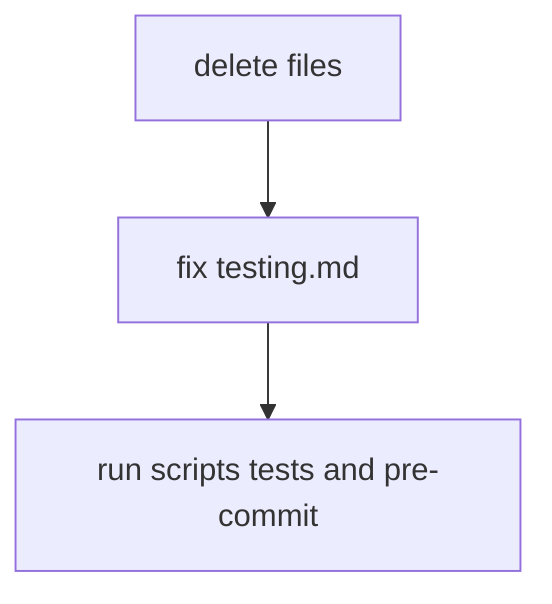
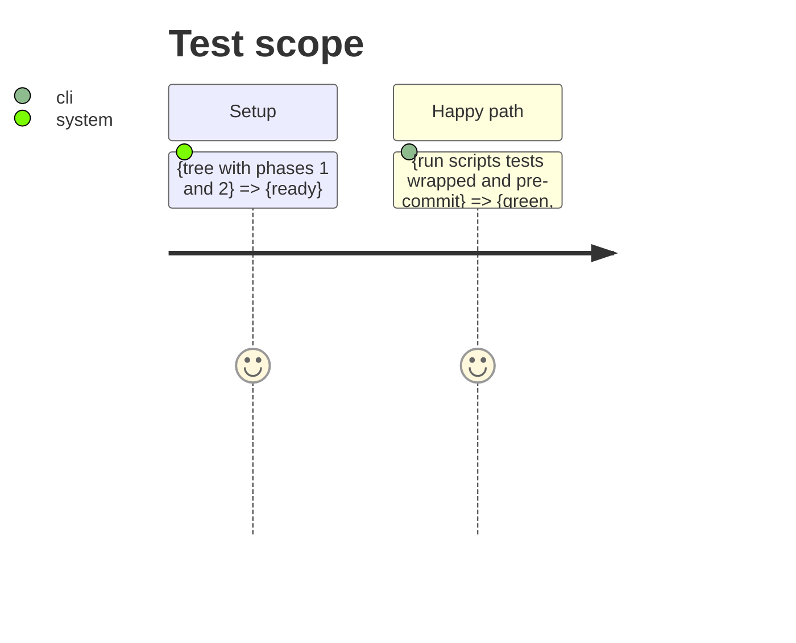

# Instruction: remove skill-eval, fix testing.md

## Architecture projection

```txt
scripts/skill-eval.mjs                   ❌ delete
scripts/skill-eval/                      ❌ delete (README.md, cases.json)
scripts/__tests__/model-selection.test.js ❌ delete, it only drives skill-eval
aidd_docs/memory/testing.md              ✏️ line 11, skills no longer validated by Test sections
```

## User Journey



## Test Scope



## Tasks to do

### `1)` Delete skill-eval and its only test

> No other consumer exists: grep found the test only.

1. Remove the three paths; grep the repo for `skill-eval`.

### `2)` Rewrite testing.md line 11

> Say how skills are really validated now.

1. Replace the `## Test` mention with the generator's validate step and the pre-commit guards.

## Test acceptance criteria

| Task | Acceptance criteria |
| ---- | ------------------- |
| 1 | `git grep skill-eval` returns nothing outside history |
| 2 | testing.md names no `## Test` section; links resolve |
