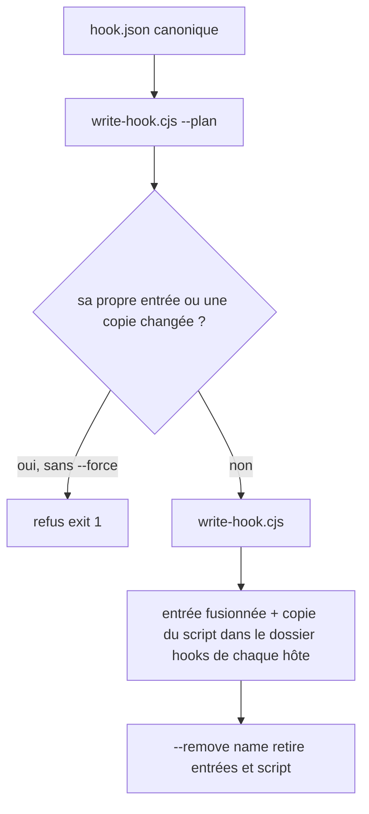
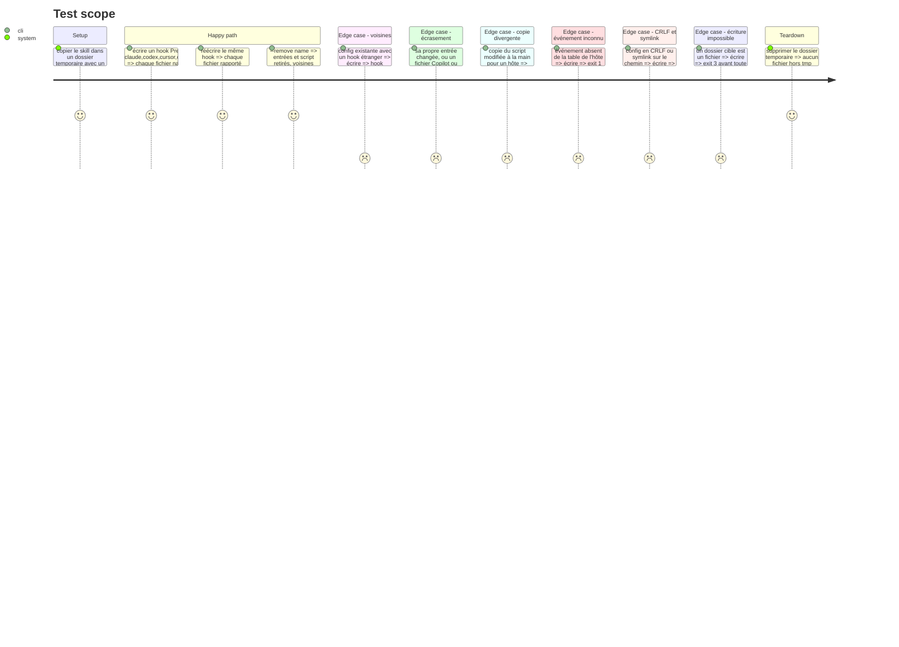

# Instruction: Writer des hôtes à config JSON

## Architecture projection

> Tree of the final files. ✅ create · ✏️ modify · ❌ delete

```txt
.
├── plugins/aidd-context/skills/08-hook-generate/scripts/
│   └── write-hook.cjs                ✅ rend et fusionne l'entrée native par hôte
└── scripts/__tests__/
    └── hook-generation.test.js       ✅ écrit d'abord, sur la copie installée du skill
```

## User Journey



## Test Scope



## Tasks to do

### `1)` Tests d'abord

> Spécifier le contrat du writer par des tests qui échouent.

1. Créer `hook-generation.test.js` sur le modèle de `command-generation.test.js` (fixture, `PATH` vide, copie installée).
2. Un test par cas du Test Scope, sorties JSON comparées exactement.
3. Lancer via le wrapper, constater l'échec « script absent ».

### `2)` Table de protocole

> Une table par hôte : chemin, forme, nom d'événement, champs OS, timeout.

1. `HOSTS` : `claude` (`.claude/settings.json`), `codex` (`.codex/hooks.json`), `cursor` (`.cursor/hooks.json`, `version: 1`), `copilot` (`.github/hooks/<name>.json`), `antigravity` (`.agents/hooks.json`, clé `<name>`).
2. Événements natifs acceptés par hôte, refus sinon.
3. Commande par hôte : `"$CLAUDE_PROJECT_DIR"/…`, `"$CURSOR_PROJECT_DIR"/…`, `cwd: "."` Copilot (résolu à la racine même depuis un sous-dossier), `"$(git rev-parse --show-toplevel)"/…` Codex, chemin relatif à `.agents/` Antigravity ; `commandWindows` et `powershell` jamais observés en trial : limite écrite, pas de code.
4. Timeout explicite par hôte dans son unité (`timeout` s, `timeoutSec`).

### `3)` Fusion, propriété, suppression

> Écrire sans perdre les voisines.

1. Lire en LF, parser, insérer ou remplacer l'entrée dont la commande nomme `hooks/<name>.` du dossier de l'hôte ; écrire la copie du script de chaque hôte, une copie divergente comptée `update`.
2. Refuser sans `--force` toute `update` : sa propre entrée changée, une copie divergente, un fichier Copilot ou une clé Antigravity du même nom. Une entrée voisine du même événement et matcher coexiste : les deux hooks tournent.
3. `--plan` : opérations `create`, `update`, `unchanged`, `delete`, rien écrit.
4. `--remove <name>` : retire ses entrées, supprime le fichier Copilot vidé et la copie du script de chaque hôte.
5. Répertoires créés avant tout fichier ; erreur FS => exit 3 avec chemin et code.

### `4)` Preuve par mutation

> Chaque garde a sa mutation.

1. Casser la conservation des voisines, le refus sans `--force` et la lecture CRLF, un à la fois ; le test nommé passe au rouge.

## Test acceptance criteria

| Task | Acceptance criteria |
| ---- | ------------------- |
| 1 | les tests échouent avant le writer, pour la raison qu'ils nomment |
| 2 | chaque hôte reçoit son fichier et sa forme natifs, un événement inconnu est refusé |
| 3 | une config voisine survit à l'écriture et à la suppression ; toute `update` exige `--force` |
| 4 | chaque mutation fait rougir le test qui la nomme |
