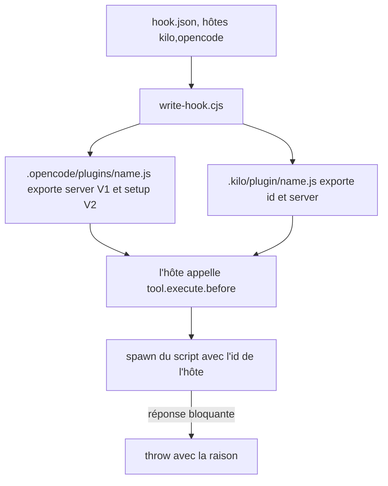
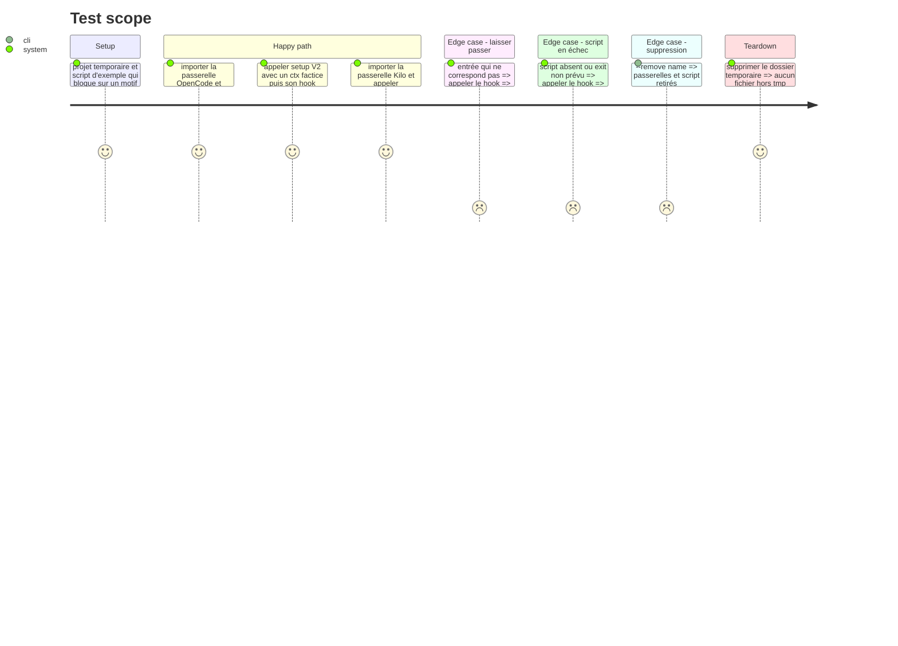

# Instruction: Plugin passerelle Kilo et OpenCode V1/V2

## Architecture projection

> Tree of the final files. ✅ create · ✏️ modify · ❌ delete

```txt
.
├── plugins/aidd-context/skills/08-hook-generate/scripts/
│   └── write-hook.cjs                ✏️ hôtes kilo et opencode, rendu de la passerelle
└── scripts/__tests__/
    └── hook-generation.test.js       ✏️ import de la passerelle avec un ctx factice
```

## User Journey



## Test Scope



## Tasks to do

### `1)` Tests d'abord

> Exécuter la passerelle rendue, pas seulement la lire.

1. Ajouter les cas du Test Scope, avec `import()` du fichier rendu et un ctx factice qui enregistre les hooks V2.
2. Constater l'échec avant le rendu.

### `2)` Rendu

> Un module autonome, modules natifs seulement.

1. OpenCode : un fichier qui exporte la fonction V1 et `setup` V2 (`ctx.tool.hook("execute.before")`), ligne d'en-tête qui nomme le hook.
2. Kilo : `export default { id, server }` avec `tool.execute.before`.
3. Commune : `spawn` du script `.opencode/hooks/<name>.<ext>` ou `.kilo/hooks/<name>.<ext>`, hors du dossier des plugins, avec l'id de l'hôte depuis `directory` (V1, Kilo) ou `ctx.location.directory` (V2), payload `{tool, args, sessionID}` sur stdin, timeout nommé, `throw` sur la réponse bloquante.
4. Propriété par la ligne d'en-tête, même règle `--force` qu'en phase 1.
5. Matcher par nom d'outil natif : `bash` en V1 et Kilo, `shell` en V2.

### `3)` Preuve par mutation

> Le blocage est prouvé.

1. Retirer le `throw` ; le test de blocage passe au rouge.

## Test acceptance criteria

| Task | Acceptance criteria |
| ---- | ------------------- |
| 1 | les tests d'exécution échouent avant le rendu |
| 2 | les deux formes OpenCode et la forme Kilo bloquent sur la réponse du script et laissent passer sinon |
| 3 | sans `throw`, le test de blocage échoue |
