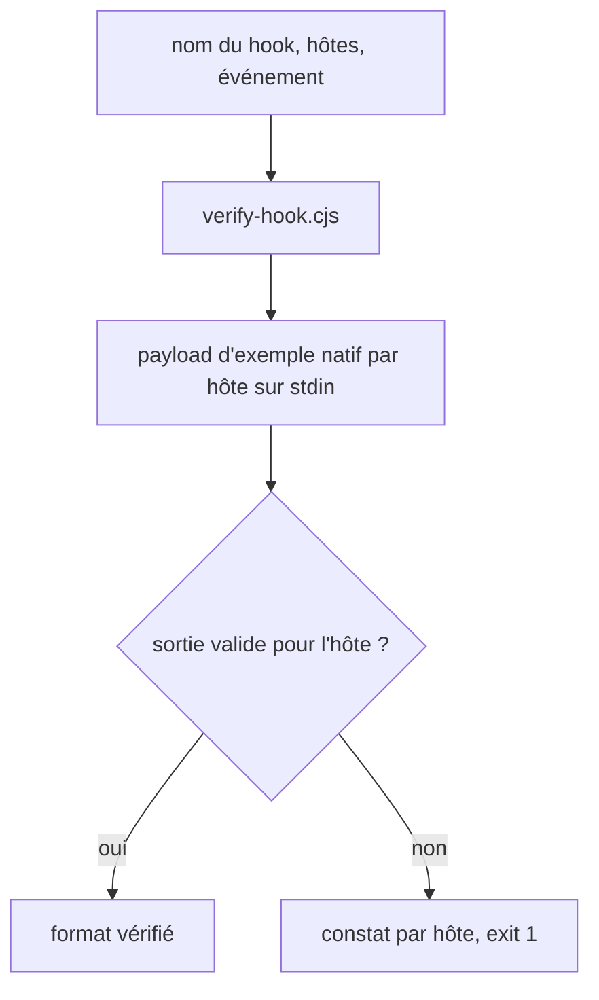
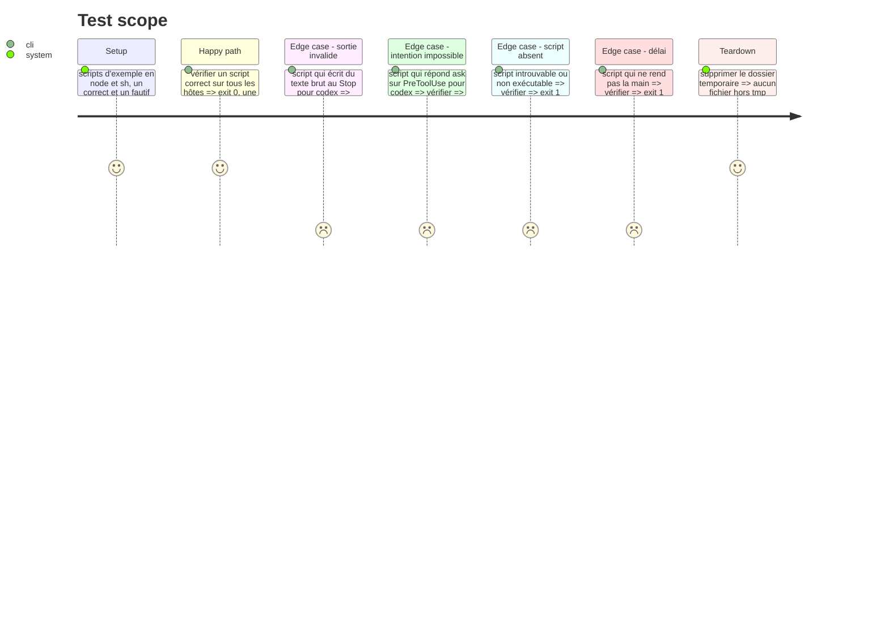

# Instruction: Vérificateur de payload

## Architecture projection

> Tree of the final files. ✅ create · ✏️ modify · ❌ delete

```txt
.
├── plugins/aidd-context/skills/08-hook-generate/scripts/
│   └── verify-hook.cjs               ✅ passe un payload d'exemple par hôte dans le script
└── scripts/__tests__/
    └── hook-verification.test.js     ✅ écrit d'abord
```

## User Journey



## Test Scope



## Tasks to do

### `1)` Tests d'abord

> Le contrat de sortie par hôte, fixé par des cas.

1. Créer `hook-verification.test.js` avec les cas du Test Scope, scripts en deux langages.
2. Constater l'échec avant le vérificateur.

### `2)` Payloads et validateurs

> Un payload d'exemple et une règle de sortie par hôte et événement.

1. Payload natif par hôte, clés relevées en spike : Claude `session_id, cwd, hook_event_name, tool_name, tool_input`, Codex idem plus `turn_id, model`, Copilot `sessionId, cwd, timestamp, toolName, toolArgs` (objet) ; Antigravity `conversationId, cwd, hookEventName, toolCall{name: run_command, args{CommandLine}}, workspacePaths, lastUserInput` avec réponse `decision` sur stdout ; Cursor d'après sa doc. Id de l'hôte en argument.
2. Valider code de sortie et JSON : clés de décision admises par hôte et événement, texte brut refusé où l'hôte le refuse.
3. Lancer chaque script avec un délai nommé ; tuer au délai.
4. Sortie JSON : un résultat par hôte, `verified` ou le constat.

### `3)` Preuve par mutation

> Les règles refusent réellement.

1. Accepter `ask` pour codex ; le test d'intention impossible passe au rouge.

## Test acceptance criteria

| Task | Acceptance criteria |
| ---- | ------------------- |
| 1 | les tests échouent avant le vérificateur |
| 2 | un script correct passe sur chaque hôte, chaque sortie invalide est nommée par hôte, quel que soit le langage |
| 3 | la mutation fait rougir le test qui la nomme |
