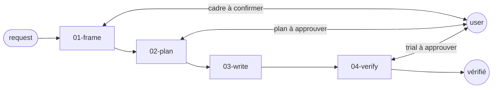
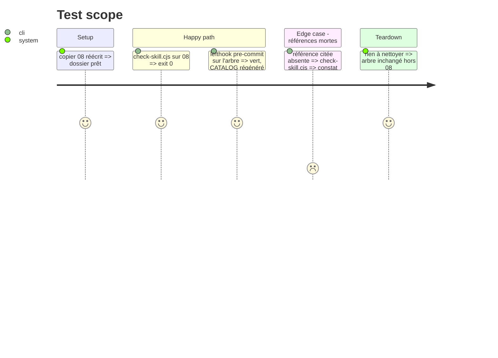

# Instruction: Skill réécrit au format de 04

## Architecture projection

> Tree of the final files. ✅ create · ✏️ modify · ❌ delete

```txt
.
└── plugins/aidd-context/skills/08-hook-generate/
    ├── SKILL.md                      ✏️ diagramme cadrage, plan, écriture, vérification
    ├── actions/
    │   ├── 01-frame.md               ✅ opération, nom, hôtes, intention, événement
    │   ├── 02-plan.md                ✅ écart par hôte et plan du writer, attente
    │   ├── 03-write.md               ✅ script puis writer
    │   ├── 04-verify.md              ✅ vérificateur, trial proposé, notes coéquipiers
    │   ├── 01-capture-hook.md        ❌
    │   ├── 02-write-hook.md          ❌
    │   └── 03-validate.md            ❌
    ├── references/
    │   ├── hosts.md                  ✅ détection, fichier, événements, réponses, coéquipiers
    │   ├── writer.md                 ✅ invocation et options des deux scripts, limites
    │   ├── hook-authoring.md         ✏️ intention, matcher précis, garde de boucle, langage libre
    │   └── tool-paths.md             ❌ remplacé par hosts.md
    └── assets/
        ├── hook-script-template.sh   ❌ langage libre
        └── hook-template.json        ❌ le writer rend les entrées
```

## User Journey



## Test Scope



## Tasks to do

### `1)` Générer avec 04

> Le skill passe par `aidd-context:04-skill-generate` en mode modification.

1. Lancer 04 sur 08 avec le cadrage approuvé ; confirmer la table du plan.
2. Supprimer le mode plugin source et le scope global, garder modifier et supprimer.

### `2)` Références

> Une seule maison par fait.

1. `hosts.md` reprend les faits vérifiés du cadrage, avec la source par hôte.
2. `writer.md` décrit les deux scripts comme le `writer.md` de 05.
3. Retirer les doublons, vérifier `check-doc-duplication`.

### `3)` Appelants

> Les pointeurs restent vrais.

1. Relire `03-context-generate`, `00-onboard`, `docs/GUIDES.md`, `docs/ARCHITECTURE.md`, `aidd_docs/CONTRIBUTING.md` ; ne modifier que ce que la refonte rend faux.

## Test acceptance criteria

| Task | Acceptance criteria |
| ---- | ------------------- |
| 1 | 08 suit le format de 04 et `check-skill.cjs` sort 0 |
| 2 | chaque fait d'hôte vit dans `hosts.md` seulement, avec sa source |
| 3 | aucun lien ni chemin cité ne pointe vers un fichier supprimé |
