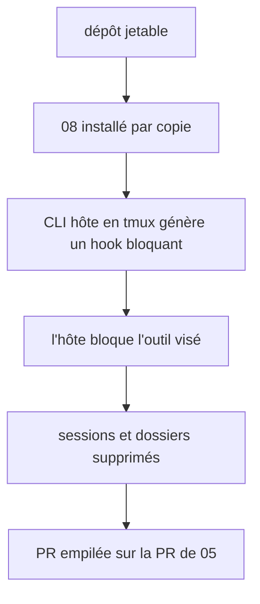
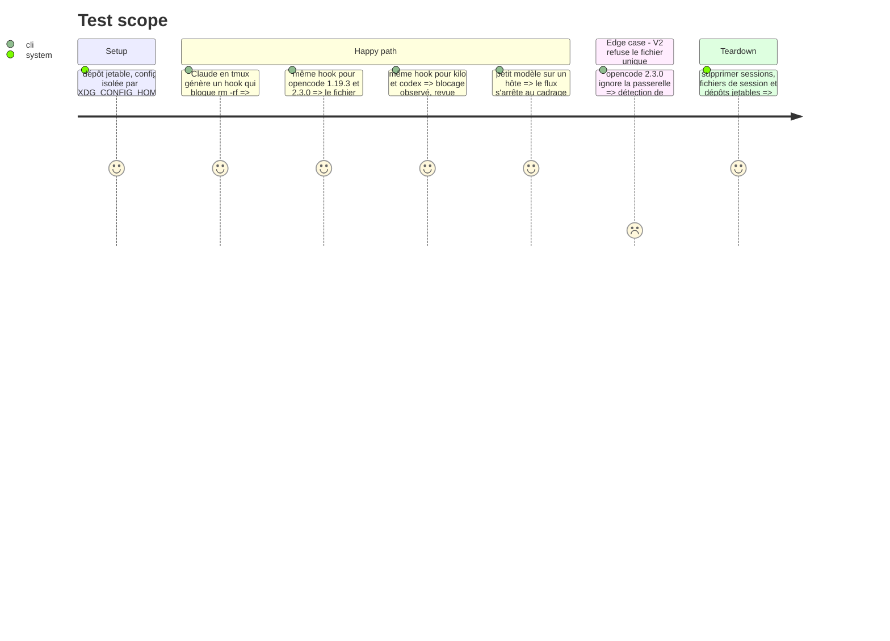

# Instruction: Trials réels et PR

## Architecture projection

> Tree of the final files. ✅ create · ✏️ modify · ❌ delete

```txt
.
└── (aucun fichier du dépôt ; dépôts jetables dans le scratchpad)
```

## User Journey



## Test Scope



## Tasks to do

### `1)` Trials

> Prouver sur les hôtes installés : claude, codex, opencode, kilo, copilot, cursor-agent si crédit.

1. Copier 08 dans un dépôt jetable par hôte, config isolée.
2. Lancer en tmux, répondre aux attentes, déclencher l'outil visé.
3. Noter le résultat par hôte ; un hôte non lancé reste « format vérifié, exécution non vérifiée ».
4. Supprimer les sessions et dossiers créés.

### `2)` PR

> Empilée sur la PR de 05, description lean.

1. Commits `--no-verify` avec les trailers, push, PR base `refactor/rule-generate-lean`.
2. Body : tests et nombres observés, trials par hôte, limites.

## Test acceptance criteria

| Task | Acceptance criteria |
| ---- | ------------------- |
| 1 | chaque hôte lancé bloque l'outil visé, et aucune session de trial ne reste |
| 2 | la PR cible la branche de 05 et ne cite que des résultats observés |

## Results

| Host | Run | Observed |
| ---- | --- | -------- |
| Claude Code 2.1.325 | `claude -p`, Haiku | `rm -rf trash` denied by the PreToolUse hook; `echo hello` ran |
| Codex 0.167.2 | `codex exec` from `sub/`, isolated `CODEX_HOME` | blocked after the hook was trusted in the TUI; an unreviewed hook is skipped silently |
| Copilot 1.0.111 | `copilot -p` from `sub/` | "Denied by preToolUse hook: hook exited with code 2"; the Claude hook in `.claude/settings.json` also ran |
| OpenCode 1.19.3 | `opencode run`, free model | `bash` call failed with the script's reason |
| OpenCode 2.3.0 | `npx @opencode/cli@2.3.0 run`, free model | `shell` call failed with the script's reason |
| Kilo 7.7.5 | `kilo run`, free model | `bash` call failed with the script's reason |
| Antigravity | `agy -p` | denied; the script started in `.agents/` |
| Cursor | not run | quota reached, and its CLI rewrites the global `cli-config.json`: format verified, run not verified |

Full skill flow on Claude Code with Haiku: stopped after the plan with nothing written, then on approval wrote both files, the verifier returned `verified`, and it offered a real trial. Every session, process and folder the trials created was deleted.
