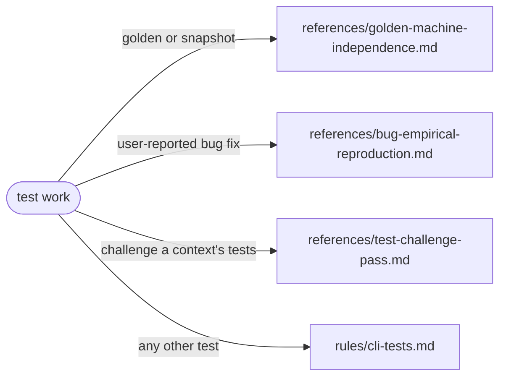

# Test

## Transversal rules

- Levels, guards, discipline and the grid live in `.claude/rules/cli-tests.md`; do not restate them here.
- Commands and fixtures live in `aidd_docs/memory/testing.md`.
- Production code belongs to the rule page of its context, under `.claude/rules/cli-contexts`, or the `tools` skill.
