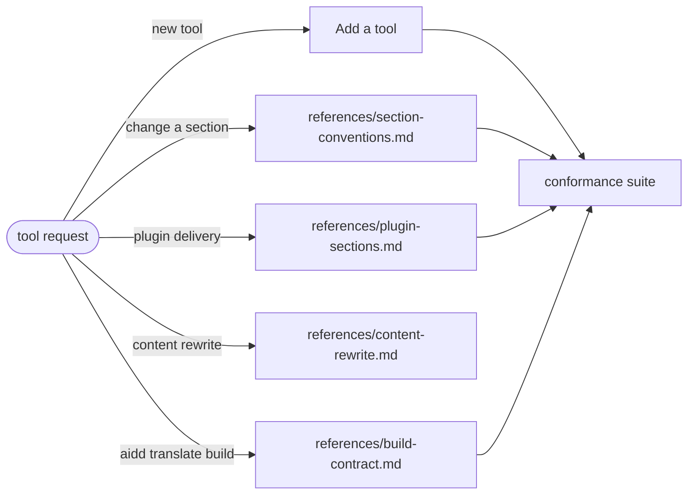

# Tools

## Transversal rules

- A profile is data built by `defineAiTool` or `defineIdeTool` in `domain/profiles/<tool>/profile.ts`; it fetches and installs nothing.
- Callers ask a profile a question and never read its structure; a new question is a method of `contract/tool-profile.ts`.
- A missing section is a missing declaration.
- No barrels: a folder has no `index.ts`.
- The rules of the context are in the `tools` page of `.claude/rules/cli-contexts/`.

## Add a tool

1. Create `domain/profiles/<tool>/profile.ts`, and `build.ts` when the tool is a build target.
2. Add one line to `REGISTERED_PROFILES` in `composition/tool-profiles.ts`, before the IDE tools.
3. Write the id once, in the profile; `tool-addition-cost.arch.test.ts` admits no other file naming a tool.
4. For a tool that runs hooks, add `hooks.ts` and one payload fixture per relayed event; a host-hook tool also adds `assets/hooks-runtime/host-<tool>.cjs`, a bridge tool reuses `host-bridge.cjs` through `declareBridgeHooks`.
5. Run the conformance suite in `tests/contexts/tools/testing/`: it walks the list and checks the profile, which needs no test of its own for declared data.

A string transform used by one profile stays in its folder; one used by two goes to `domain/formats/`.
