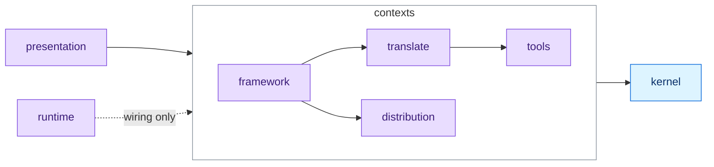

# Architecture

## Contexts, not layers

| Where | Holds |
| --- | --- |
| `src/kernel/` | The vocabulary every context speaks: tool identity, source location, paths, files, fingerprints, merge strategies, errors, ports shared by two contexts or more. Imports no context. No business logic. |
| `src/contexts/tools/` | What the project targets and how each target is configured. One directory per tool: its profile beside its build contracts. |
| `src/contexts/translate/` | Canonical source into target-native content, at every level. |
| `src/contexts/distribution/` | Where content comes from and how it is fetched. A leaf: knows no tool and no installation record. |
| `src/contexts/framework/` | The installation record and everything done to a project. The only context allowed to reach the others. |
| `src/presentation/` | What speaks to a human: commands, display, prompts, output. |
| `src/runtime/` | Technical services and wiring: auth, http, git, platform, project root, self-update, one wiring module per context. |

## Invariants

None is enforced by this document.

| Invariant | Held by |
| --- | --- |
| Which contexts may see each other | `tests/architecture/context-graph.arch.test.ts` allows exactly the edges above. The forbidden edges the tree still has are listed in that file |
| What of a context is visible | `tests/architecture/context-boundary.arch.test.ts` refuses an import into a context's interior. There is no barrel file |
| Which way the layers point | Biome overrides. `application` calls `domain`, never the reverse. `application` takes a port and never calls `infrastructure` |
| What the kernel may know | A biome override refuses a kernel import from any context. `tests/architecture/earned-sharing.arch.test.ts` measures what belongs there |
| The layer rules still bite | `tests/architecture/import-rules-bite.arch.test.ts` checks each override names a path that exists |

- Every context on disk must appear in the boundary list, or it is skipped instead of held.
- The layer rule covers type-only imports, dynamic imports and any depth of `../`.
- A domain file may import `node:path` and `smol-toml`: both are pure.
- The rule keeps I/O and human interaction out of the domain, not imports.

## Domain models

Manifest v6.

| Model | Is |
| --- | --- |
| `SetupFlow` | Aggregate of all setup parameters: source, tools, plugin mode, interactive |
| `MarketplaceSourceMode` | Value object: `remote()` or `local(path)` |
| `Marketplace` | A registered marketplace: name, source, scope. Registry in `.aidd/marketplaces.json`, not in the manifest |
| `MarketplaceCacheEntry` | A cached catalog fetch: marketplace name, fetchedAt, size |
| `Manifest` | `version` and `tools`. Plugins live per tool under `tools[id].plugins`. Stored in `.aidd/manifest.json` |
| `Plugin` | An installed plugin: id, source (marketplace and version), tool, files |
| `PluginDistribution` | The capability files of a plugin, as fetched from its source |

## Command grammar

| Form | Meaning | Commands |
| --- | --- | --- |
| Bare verb | An action now, on the CLI or the project | `setup`, `doctor`, `sync`, `translate`, `update`, `clean` |
| Noun, then verb | A resource lifecycle | `framework`, `plugin`, `marketplace`, `auth`, `telemetry` |

Every command: [CLI reference](README.md#commands).

## Plugins

| Fact | Detail |
| --- | --- |
| Distribution | Marketplace catalogs: Git repos with `marketplace.json` and `plugins/` |
| Capability files | Agents, commands, hooks, mcp, rules, skills, per AI tool format |
| Translation | The CLI rewrites a plugin between tool formats, reverse then forward |
| Memory files | `CLAUDE.md`, `AGENTS.md`, `copilot-instructions.md` belong to the `aidd-context` plugin, not the CLI binary |

## Translate

| Fact | Detail |
| --- | --- |
| Strategies | `MarketplaceBuildStrategy` and `FlatBuildStrategy` read a per-tool `ToolBuildContract`, with no per-tool branching |
| Emitted | Skills, agents, mcp, hooks |
| Skipped | Rules and commands, with a warning per plugin |
| Targets and layouts | [CLI reference](README.md#translate) |

## Hook adaptation

OpenCode needs JS adapters.

| Owner | Owns |
| --- | --- |
| The CLI | The shared host protocol |
| Plugins | The mapping of their own payloads |

- The helper is delivered once, outside plugin discovery.
- It is tracked as a tool file, and backfilled only when missing.
- Installation never rewrites user configuration, and never claims an existing untracked helper.
- `SessionStart` runs idempotently at host initialization.
- Unsupported hooks and skipped surfaces are reported.

Which tools run hooks: [Compatibility](../docs/COMPATIBILITY.md).

Plugin root per tool

Hooks are authored with `${CLAUDE_PLUGIN_ROOT}`. The installer translates it per tool.

| Tool | Plugin root | Note |
| --- | --- | --- |
| Claude Code | `${CLAUDE_PLUGIN_ROOT}` | Authoring spelling, nothing substituted |
| Codex | `${PLUGIN_ROOT}` | Also expands `${CLAUDE_PLUGIN_ROOT}` |
| GitHub Copilot | `${PLUGIN_ROOT}` | |
| Cursor | `./` | Own hook format: the converter makes the root plugin-relative before token substitution |
| OpenCode, Kilo Code | none | No hooks file: a generated bridge replays the hooks |

Runtime contracts:

- [Hook bridge](src/contexts/tools/domain/profiles/opencode/opencode-hooks-bridge.ts)
- [Shared V2 adapter](assets/configs/opencode/opencode-events.js.txt)
- The helper is `.opencode/hooks/opencode-events.js`.

## Dependency wiring

| Function | Builds |
| --- | --- |
| `createDeps(projectRoot, globalOptions, output)` | The full dependency graph, memoized per project root |
| `createMenuDeps()` | The pre-parse part only: `ManifestRepository` and `Prompter` |

`deps.ts` assembles every adapter. Commands never instantiate adapters.

## Tests

| Suffix | Covers |
| --- | --- |
| `*.unit.test.ts` | Domain models and pure functions, no I/O |
| `*.integration.test.ts` | Use cases and adapters, on a real temp filesystem |
| `*.e2e.test.ts` | The full CLI binary through `runCli()`, one temp dir per test |
