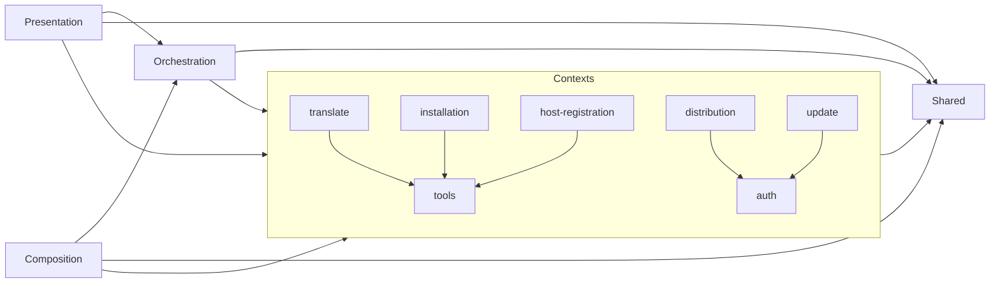

# Architecture

## Dependencies

Inter-context edges are exactly `ALLOWED` in `tests/architecture/allowed-edges.ts`, held by `context-graph.arch.test.ts`.

## Decisions

| Decision | Why |
| --- | --- |
| Another context is read through its `contract/` only | its `domain/`, `ports/` and `infrastructure/` stay its own; `context-graph.arch.test.ts` holds it, and Biome for the `HELD_BY_BIOME` contexts |
| A module is shared only with callers in two contexts | `earned-sharing.arch.test.ts`; one caller means the code belongs to it |
| Record placement: the host record's shape lives in `host-registration/domain/`, the manifest stores it opaque | only host registration knows what it means; the manifest keeps its own claims on refs |
| Claude registers at `--scope local` | the hashed settings file keeps one writer (`profiles/claude/profile.ts`) |
| Files this CLI owns are regenerated, co-owned files are merged | `MergeStrategy` in `shared/domain/merge.ts` |
| The manifest reads one version and refuses the rest | the refusal names the fix; no migration chain |
| One hooks descriptor per tool, one merge engine, one host adapter per tool in `assets/hooks-runtime/` | adding a tool is a descriptor and a payload fixture |

Decision records: `internal/decisions/`.

## Gotchas

- Configs are inlined at build time, schemas are copied beside the binary by `tsup.config.ts`.
- The build empties its output directory; `AIDD_BUILD_OUT_DIR` accepts `dist` or a directory under `.e2e-build/`.
- `git` exports `GIT_*` into everything it spawns; strip them before reading a repository.
