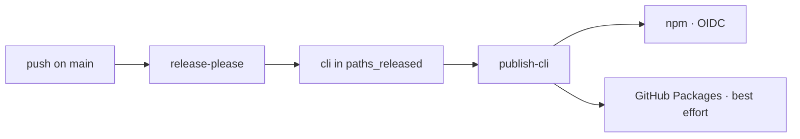

# Deployment

## Pipeline

- `.github/workflows/cli-ci.yml` has no `on.paths` filter, so its required check is always satisfiable; its `changes` job decides relevance from the diff.
- Every other job runs only when `changes` says relevant, and the `gate` job (`cli / gate`) fans them in and is the one check `.github/rulesets/` requires.
- `pnpm build` copies the JSON schemas the binary reads at runtime, then `scripts/check-bundle-size.mjs` enforces `bundleBudgetKB`.
- `AIDD_BUILD_OUT_DIR` accepts only `dist` or a directory under `.e2e-build/`, because the build empties its target.

## Release

- release-please tags this package `cli-v<semver>`; a bare `v<semver>` is the root marketplace.
- `publish-cli` runs when `cli` appears in `paths_released`, never on a tag, so a root or plugin release publishes nothing here.
- npm is the load-bearing step, an `npm publish` under OIDC with no token; the GitHub Packages step is `continue-on-error`.
- `aidd update` reads the latest version from npm dist-tags, per `internal/decisions/self-update-version-source-npm.md`.
- npm answers a GitHub `Accept` header with 406, so a registry read must set `application/json`.
