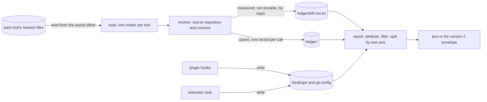

# Telemetry

A map to the code for contributors. Formats, rules and stores: [usage contract](../../../../aidd_docs/product/usage-contract.md). Usage: [plugin README](../../../../plugins/aidd-telemetry/README.md).

## Adding a tool

| Edit | Where |
| --- | --- |
| its line format, a pure `decode(line, context?)` returning the context a later line needs | `src/contexts/telemetry/infrastructure/sources/claude/` or `sources/codex/` |
| its transcript source, on the block reader | `src/contexts/telemetry/infrastructure/sources/transcript-files.ts` |
| one reader in the ingest list | `src/composition/telemetry.ts` |
| its name | `USAGE_TOOLS` in `src/contexts/telemetry/contract/usage-record.ts` |
| its home relocated in every sandbox that runs the CLI | `tests/shared/testing/cli-sandbox.builder.ts`, `tests/contexts/telemetry/testing/telemetry-sandbox.builder.ts`, `scripts/check-claude-tokens-end-to-end.cjs`, `scripts/probe-identifier-join.cjs` |

## Data flow

- A report ingests new lines first, under the ledger lock (`application/report/report-usage.use-case.ts`, `application/ingest-usage.use-case.ts`).
- A transcript is read a block at a time (1 MiB), never the unread tail whole, so an ingest holds about three copies of the longest line.
- A rewrite, a shrink or a replacement during a read: [residual limits](../../../../aidd_docs/product/usage-contract.md#residual-limits).
- A report's envelope keeps its figures apart from its `run`: [the envelope reference](../../../../plugins/aidd-telemetry/skills/01-usage/references/envelope.md#figures-and-run).
- Reading is tool-specific only up to the usage record.
- Resolving, storing, attributing and reporting are written once.
- The hooks and the CLI never call each other's code and meet only in files.
- One fixture pins those formats on both sides: `scripts/__tests__/fixtures/telemetry-bindings/`, read by `tests/contexts/telemetry/telemetry-bindings-fixture.integration.test.ts` and the hook tests.
- The plugin's hooks are plain Node under `plugins/aidd-telemetry/hooks/`, which tell Claude Code's payload from Codex's in `hooks/lib/tool.cjs`.
- The plugin runs `aidd telemetry ingest --quiet` at session start (`plugins/aidd-telemetry/hooks/catch-up.cjs`).
- Another tool's calls are attributed by branch, and hooks name the session with `AIDD_TELEMETRY_SESSION_ID` where the tool sets no variable.

## Where to look

| Question | Under `src/contexts/telemetry/` |
| --- | --- |
| Why a call is counted once | `domain/usage-fold.ts` |
| Where a call's repository comes from | `application/directory-resolver.ts`, `domain/repository-identity.ts` |
| Which task a call belongs to | `domain/report/attribution.ts`, `domain/declaration/binding-resolution.ts` |
| Whether a branch is declared, mirrored by `plugins/aidd-telemetry/hooks/lib/git.cjs` | `domain/branch-binding.ts` |
| What counts as consent, and when a clone consented | `domain/telemetry-consent.ts`, `domain/consent/consent-history.ts`, `infrastructure/git/git-consent-adapter.ts` |
| What a clone is | `domain/consent/clone-identity.ts` |
| How a transcript is read from its saved offset | `infrastructure/sources/transcript-files.ts`, `domain/transcript-position.ts` |
| Why a Codex file that moved is read from its start | `infrastructure/sources/codex/codex-transcript-source-adapter.ts` |
| How the ledger lies on disk | `infrastructure/storage/ledger/usage-ledger-adapter.ts`, `application/ledger-upkeep.ts` |
| What an ingest measured and could not store | `infrastructure/storage/ledger/left-out-adapter.ts` |
| How an id an earlier version gave a repository joins the id of now | `domain/legacy/repository-aliases.ts` |
| Who the measurement names, and what `on` offers | `domain/identity/person-identity.ts`, `application/identity/`, `infrastructure/git/git-user-source-adapter.ts` |
| What `forget` erases of an earlier measurement | `domain/legacy/legacy-locations.ts`, `application/forget/` |
| The report axes and the envelope | `domain/report/usage-report.ts`, `application/report/report-envelope.ts` |
| What a report's filters select | `domain/report/report-filter.ts` |

## Tests

- A port's contract suite is a file of `tests/contexts/telemetry/ports/`, run against its fake and its real adapter.
- Each tool's line format is pinned by anonymized records in `tests/fixtures/claude-usage/` and `tests/fixtures/codex-usage/`.
- `tests/e2e/telemetry-journey.e2e.test.ts` drives the plugin's real hooks through a shim to the built binary.
- `pnpm test:foreign-clock` (`scripts/test-foreign-clock.mjs`) runs the telemetry tests with `TZ` `Pacific/Kiritimati` and locale `ar_SA.UTF-8`, and CI runs it in `cli-coverage`.
- A test that compares figures across zones sets `TZ` itself, while the locale is fixed at process start, so only a child process varies it.
- `scripts/__tests__/telemetry-skills-name-real-commands.test.js` checks the skills' commands against the help golden.
