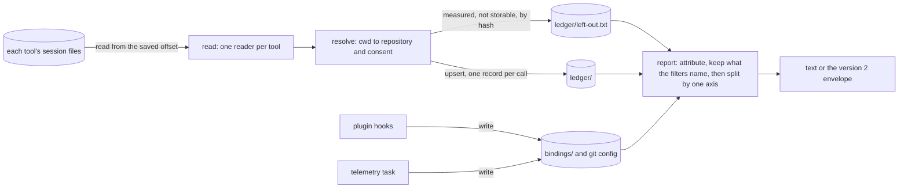

# Telemetry

> For: contributors. A map to the code. Formats, rules and stores: [usage contract](../../../aidd_docs/product/usage-contract.md). Usage: [plugin README](../../../plugins/aidd-telemetry/README.md).

## Adding a tool

| Edit | Where |
| --- | --- |
| its line format | `contexts/telemetry/domain/formats/` |
| its transcript source | `contexts/telemetry/infrastructure/` |
| one reader in the ingest list | `runtime/wiring/telemetry.ts` |
| its name | `USAGE_TOOLS` in `domain/usage-record.ts` |

Storage, attribution and the report need nothing. Session declarations come from Claude's hooks only (release 1): another tool's calls are attributed by branch.

## Data flow

- A command that reports or ingests reads new lines first, under the ledger lock. `ingest` is the same step on its own, run quietly by the plugin at session start.
- A transcript is read a block at a time (1 MiB), each complete line handed on as it is found, never the unread tail whole. An ingest holds a block, up to about three copies of the longest line at once (its pieces, the joined bytes, the decoded string), and what the reading keeps: every record and every unrecognised line naming a directory. An unterminated last line waits for the next read. A transcript that shrank while it was read counts none of that read and keeps its position, to be read again. One replaced at its path meanwhile is read as it was opened, whole.
- A report's envelope keeps its figures apart from its `run`: defined once in [the envelope reference](../../../plugins/aidd-telemetry/skills/01-usage/references/envelope.md#figures-and-run).
- Reading is one pass: tool-specific only up to the usage record. Resolving, storing, attributing and reporting are written once for every tool.
- The hooks and the CLI never call each other's code. They meet in the files, whose formats one fixture pins on both sides.

## Layers

| Layer | Path under `cli/src/` | Holds |
| --- | --- | --- |
| Presentation | `presentation/commands/telemetry.ts`, `presentation/display/telemetry*` | the command group: `on`, `off`, `forget`, `ingest`, `task`, `status`, `report`, `identity` |
| Composition | `runtime/wiring/telemetry.ts` | the telemetry directory, the environment variables, every use case wired |
| Application | `contexts/telemetry/application/` | one use case per command, the directory resolver, `report/` |
| Domain | `contexts/telemetry/domain/` | the usage record and its fold, the declaration and attribution rules, consent, the report axes |
| Infrastructure | `contexts/telemetry/infrastructure/` | the ledger, locks, git config and file stores, the transcript source |

## Where to look

| Question | File |
| --- | --- |
| What a Claude Code line becomes | `domain/formats/claude-transcript-usage.ts` |
| Why a call is counted once | `domain/usage-fold.ts` |
| Where a call's repository comes from | `application/directory-resolver.ts`, `domain/repository-identity.ts` |
| Which task a call belongs to | `domain/report/attribution.ts`, `domain/declaration/binding-resolution.ts` |
| Whether a branch is declared: only by `task`, on that branch (`aiddDeclaredAt` set, `aiddDeclaredFor` absent or equal to the branch); the hook's twin is `plugins/aidd-telemetry/hooks/lib/git.cjs` | `domain/branch-binding.ts` `parseBranchConfig`; rule and limits in the [usage contract](../../../aidd_docs/product/usage-contract.md#branch-declaration) |
| What counts as consent | `domain/telemetry-consent.ts`, `infrastructure/git-consent-adapter.ts` |
| Whether a call is stored | `application/directory-resolver.ts` |
| What a clone is | `domain/consent/clone-identity.ts` |
| When a clone consented | `domain/consent/consent-history.ts`, `application/consent-log.ts` |
| Which transcripts are read | `application/ingest-usage-use-case.ts`, `application/read-usage-use-case.ts` |
| How one is read: from its saved offset, a block at a time, up to its last complete line | `infrastructure/claude-transcript-source-adapter.ts`, `domain/transcript-position.ts` |
| How the ledger lies on disk, and what an ingest or a report reads | `infrastructure/usage-ledger-adapter.ts`, `domain/stored-usage.ts`, `application/ledger-upkeep.ts`, `domain/report/period.ts` |
| What an ingest measured and could not store, kept for every report (`ledger/left-out.txt`), and why a ledger line no reader knows is kept | `infrastructure/left-out/left-out-adapter.ts`, `infrastructure/usage-ledger-adapter.ts`, `application/ingest-usage-use-case.ts`; rules in the [usage contract](../../../aidd_docs/product/usage-contract.md#left-out) |
| What `on` and `forget` clean up from an earlier measurement | `domain/legacy/`, `application/switch/`, `application/forget/` |
| The report axes and the envelope | `domain/report/usage-report.ts`, `application/report/report-envelope.ts` |
| Who the measurement names, and what `on` offers | `domain/identity/person-identity.ts`, `application/identity/`, `infrastructure/identity/git-user-source-adapter.ts`; the question is the `on` command's |
| What a report's `filters` select (`--task`, `--ticket`, `--person`, `--model`, `--agent`, `--session`, `--repository`, `--absent`, `--unattributed`), and where a start of an id or `.` is resolved | `domain/report/report-filter.ts`, `application/report/report-usage-use-case.ts` |

## The plugin side

`plugins/aidd-telemetry/hooks/` is plain Node and imports nothing from here. It asks for a task, answers a typed declaration by running `aidd telemetry task`, and records which session a process is on. Its reading of the stores is pinned against `scripts/__tests__/fixtures/telemetry-bindings/`, read by `tests/contexts/telemetry/telemetry-bindings-fixture.unit.test.ts` and by the hook tests.

## Tests

- Unit and integration tests mirror `src/` under `tests/contexts/telemetry/`.
- The `telemetry` end-to-end tests under `tests/e2e/` run the built binary; `tests/e2e/telemetry-journey.e2e.test.ts` drives the plugin's real hooks through a shim to it and checks that every axis adds up to the total.
- `pnpm test:foreign-clock` (`scripts/test-foreign-clock.mjs`) runs the telemetry tests with the clock in `Pacific/Kiritimati` and the locale `ar_SA.UTF-8`, after checking that a child Node really sees both. CI runs it in `cli-coverage`. A test that compares figures across zones sets `TZ` itself; the locale is fixed at process start, so only a child process can vary it.
- The skills' commands are checked against the help golden by `scripts/__tests__/telemetry-skills-name-real-commands.test.js`.
