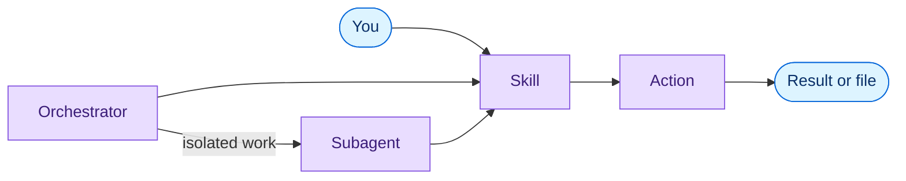

# Architecture

Where a capability belongs.

Terms: [Concepts](CONCEPTS.md).

## Anatomy of a plugin

Only the manifest and the skills are required.

| Component | Location |
| --- | --- |
| Manifest | `.claude-plugin/`, holding `plugin.json` |
| Skill | `skills/<name>/SKILL.md` |
| Actions | `skills/<name>/actions/` |
| Assets | `skills/<name>/assets/` |
| References | `skills/<name>/references/` |
| Agents | `agents/` |
| Commands | `commands/` |
| Hooks | `hooks/hooks.json` and its scripts |
| MCP configuration | `.mcp.json` |
| Documentation | `README.md`, `CATALOG.md` (generated), `CHANGELOG.md` |

Project rules live in your tool's rules directory, such as `.claude/rules/`.

`aidd-context` generates them.

## Who owns what

Put each capability in the plugin that owns its concern.

Every other plugin delegates to it.

| Plugin | Owns |
| --- | --- |
| `aidd-context` | Project knowledge: memory, context files, generators |
| `aidd-pm` | Product management: briefs, epics, stories, specs |
| `aidd-refine` | Thinking about the work: brainstorm, challenge, fact-check |
| `aidd-dev` | Code: plan, build, validate, review, debug |
| `aidd-vcs` | Version control: commits, pull requests, tags |
| `aidd-orchestrator` | Running other skills end to end |
| `aidd-ui` | UI and UX design |
| `aidd-qa` | Acceptance QA with video evidence |
| `aidd-telemetry` | Token measurement |

## How a skill runs



| Role | Rule |
| --- | --- |
| Skill | Runs in the caller's context. Holds no logic, only its actions. |
| Caller | The session or skill that delegates. Owns scope, integration and acceptance. |
| Orchestrator | Sequences capabilities for the caller. |
| Subagent | Takes a scoped brief and returns only a result to the caller. Never calls an orchestrator. |
| Delegation | At most two layers, no cycles. |

## Rules that keep plugins independent

1. A skill links only inside its own directory.
2. A bundled script is named in backticks, never linked.
3. Address another plugin as `/plugin:folder` only in dispatch tables and orchestration references.
4. Find a provider in another plugin by its description.
5. Keep a bundled script's tests in `scripts/__tests__/`, never in the plugin.
6. Write only what the target tool supports.
7. Delegate agent work by responsibility, never by agent name.

## Hooks

The contract every hook the framework ships follows. It binds the framework's own hooks only: a hook a user generates with `aidd-context:08-hook-generate` stays free of it.

A hook adds determinism where a model drifts. It checks mechanical rules: a rule a script decides with no judgment, reading as many files as it needs. A rule that needs judgment belongs to the skill's check and to CI.

### Levels and moments

A level is what the finding demands; a moment is when the artifact is final.

| Level | Effect | Mechanism | Used when |
| --- | --- | --- | --- |
| 1. Inform | the model reads the finding and decides | `additionalContext` | the rule is certain but a deviation can be legitimate |
| 2. Require | the model must fix before going on | `decision: "block"` with `reason` | the rule is certain, has no false positive on real data, and the fix is local |

| Moment | Event | For |
| --- | --- | --- |
| After the write | PostToolUse | an artifact final in one write: a memory file, a frontmatter |
| At the turn end | Stop, once per turn, scoped to what the turn reached | an artifact final only after several writes |

SessionStart keeps a generated state true, silently: its text never reaches the model on OpenCode or Kilo. No level stops a write: PreToolUse sees an `Edit` fragment, not the final file, and would block drafts. A rule never fires where its artifact is still in progress. UserPromptSubmit and SessionEnd are out of the contract, except for `aidd-telemetry`, whose job is observing a session.

Placing a gap:

1. Needs judgment? Then no hook.
2. When is the artifact final? One write: after the write. Several: at the turn end.
3. False positives on real data? Some: level 1. None: level 2 if the fix is local, else level 1.

### Rules

1. **Owner scope.** A hook checks the paths its plugin owns and exits before reading anything else. `aidd-context` also owns the layout of `aidd_docs/`, never the content of another plugin's folder.
2. **One neutral interface.** A hook reads its event and answers through `hooks/lib/host.cjs`, never a host's payload directly. A `files` entry carries `written`, the text this write put in the file, and `replaced`, the text it replaced, each absent where the host gives none. An entry may name a file that no longer exists, so a hook tolerates `ENOENT`. `continueTurn` asks once, and prints nothing when the Stop is already a continuation.
3. **Findings only.** Report what this write or this turn produced, never the project's standing errors: every error on the lines this write added or changed, one line each, counted as a multiset (a whole-file write changes every line). When those lines are unknown (a shell write, an edit without `written`, a write that only removed lines), the file's errors are grouped under its name and only inform. Never report another file or a missing file. Warnings follow, capped at 10. Silence when clean.
4. **One entry per concern.** `node ${CLAUDE_PLUGIN_ROOT}/hooks/<concern>.cjs hook|check|sync`: the same file runs by hand, from a skill and in CI, with the same result. Everything it calls lives under `hooks/`.
5. **Node built-ins only.** CommonJS, `fs`, `path`, `os`. No dependency, child process, git or network.
6. **Bounded.** A 5 s declared timeout, the work well under a second. Exit 0 on garbage, empty stdin or an unknown event; an internal failure answers nothing.
7. **Stateless, except a turn-end check.** A plugin with a Stop check keeps one file per session listing the paths the turn wrote, under `<os.tmpdir()>/aidd-hooks-<uid>/<plugin>/<session>`, owner-only, cleared at Stop, swept after 24 h. No mark, no Stop check. A shell command that may have written marks the line `unknown`, which scopes the check to the watched folders. A read-only command marks nothing. A write the forms miss is seen late, by the next write, the skill's check or CI, never lost.

The finding format:

```
<plugin>: <n> errors, <m> warnings
<file>[:<line>] <rule> ["<excerpt>"] => <fix>
<rule> ×<count> in <file>|<folder>/* ["<excerpt>"] => <fix>
<file>[:<line>] <rule> warning <message> => <fix>
```

Line and excerpt are optional. A group of one prints the plain error line. A group prints an excerpt only when every member has the same one. The line carries the fix, never "rerun this command".

### Shared code

`hooks/lib/common-rules.cjs` is copied into each plugin and held identical by `scripts/check-hook-rule-copies.js`: `deadPaths` (a backticked path that does not exist), `isShellWrite` (the shell forms that write or move files) and `formatFindings` (the format above).

### What the CLI carries

| Concern | Where |
| --- | --- |
| Hook config per tool: destination, wrapper, event map, fields kept, root token | one descriptor per tool, `profiles/<tool>/`, data only |
| Merge and unmerge of one plugin's entries | one engine, used by every route that writes hooks |
| Payload in, answer out | one adapter per host in `cli/assets/hooks-runtime/`, same exports. The plugin tree ships Claude's as `hooks/lib/host.cjs`; the build replaces it with the target's. The hook command never changes, no extra process runs, and nothing calls the `aidd` binary at run time |
| Adding a tool | one descriptor and one captured payload fixture; the contract test fails when either is missing |

A Codex or Copilot `apply_patch` becomes one event listing every file it touched. The event names its `host` and keeps the host's payload as `raw`, so a hook that needs a host field still reads it. Where a host does not deliver a level 2 answer to the model, its adapter answers at level 1.

More: [Maintainers guide](MAINTAINERS.md), [CLI architecture](../cli/ARCHITECTURE.md).
