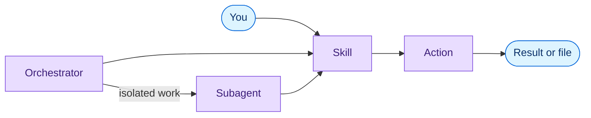

# Architecture

Where a capability belongs.

Terms: [Concepts](CONCEPTS.md).

## Anatomy of a plugin

Only the manifest and the skills are required.

| Component | Location |
| --- | --- |
| Manifest | `.claude-plugin/`, holding `plugin.json` |
| Skill | `skills/<name>/SKILL.md` |
| Actions | `skills/<name>/actions/` |
| Assets | `skills/<name>/assets/` |
| References | `skills/<name>/references/` |
| Contract | `skills/<name>/scripts/contract.json`, its rules for the files the skill writes |
| Agents | `agents/` |
| Commands | `commands/` |
| Hooks | `hooks/hooks.json` and its scripts |
| MCP configuration | `.mcp.json` |
| Documentation | `README.md`, `CATALOG.md` (generated), `CHANGELOG.md` |

Project rules live in your tool's rules directory, such as `.claude/rules/`.

`aidd-context` generates them.

## Who owns what

Put each capability in the plugin that owns its concern.

Every other plugin delegates to it.

| Plugin | Owns |
| --- | --- |
| `aidd-context` | Project knowledge: memory, context files, generators |
| `aidd-pm` | Product management: briefs, epics, stories, specs |
| `aidd-refine` | Thinking about the work: brainstorm, challenge, fact-check |
| `aidd-dev` | Code: plan, build, validate, review, debug |
| `aidd-vcs` | Version control: commits, pull requests, tags |
| `aidd-orchestrator` | Running other skills end to end |
| `aidd-ui` | UI and UX design |
| `aidd-qa` | Acceptance QA with video evidence |
| `aidd-telemetry` | Token measurement |

## How a skill runs



| Role | Rule |
| --- | --- |
| Skill | Runs in the caller's context. Holds no logic, only its actions. |
| Caller | The session or skill that delegates. Owns scope, integration and acceptance. |
| Orchestrator | Sequences capabilities for the caller. |
| Subagent | Takes a scoped brief and returns only a result to the caller. Never calls an orchestrator. |
| Delegation | At most two layers, no cycles. |

## Rules that keep plugins independent

1. A skill links only inside its own directory.
2. A bundled script is named in backticks, never linked.
3. Address another plugin as `/plugin:folder` only in dispatch tables and orchestration references.
4. Find a provider in another plugin by its description.
5. Keep a bundled script's tests in `scripts/__tests__/`, never in the plugin.
6. Write only what the target tool supports.
7. Delegate agent work by responsibility, never by agent name.

## Hooks

The contract for the framework's own hooks, not for a hook a user generates with `aidd-context:08-hook-generate`. `aidd-context`, `aidd-dev` and `aidd-pm` follow it; `aidd-ui` adopts it in its own change. `aidd-telemetry` stays outside.

A hook checks mechanical rules only; a rule that needs judgment belongs to the skill's check and to CI.

### Levels and moments

| Level | Effect | Mechanism | When |
| --- | --- | --- | --- |
| 0. None | no hook | | the check needs judgment |
| 1. Inform | the model reads the finding and decides | `additionalContext` | the rule is certain but a deviation can be legitimate, or it has a false positive on real data |
| 2. Require | the model fixes before going on | `decision: "block"` with `reason` | the rule is certain, has no false positive on real data, and the fix is local |
| 3. Refuse | the write does not happen | the host's deny, through `refuse(reason)` | the file on disk declares itself frozen, such as a spec whose status is `locked`; never judged on the written content, whose `Edit` fragment would block drafts |

| Moment | Event | For |
| --- | --- | --- |
| Session start | SessionStart | keeping a generated state true, silently |
| Prompt sent | UserPromptSubmit | holding a prompt until the work has a declared task (`aidd-telemetry`) |
| Before the write | PreToolUse | refusing a write to a frozen file |
| After the write | PostToolUse | an artifact final in one write: a memory file, a frontmatter |
| Turn end | Stop, once per turn | an artifact final after several writes; asks once to fix the errors on the lines the turn changed |
| Session end | none | unused: nothing is left to fix |

### Rules

| Rule | Says |
| --- | --- |
| Owner scope | A hook checks the paths its plugin owns and exits before reading anything else. `aidd-context` also owns the layout of `aidd_docs/`; `aidd-dev` and `aidd-pm` own the artifacts their skills' contracts name. |
| One neutral interface | Read and answer through `hooks/lib/host.cjs`, never a host's payload. `readEvent()` gives the event and its `files` (`written`, `replaced`, absent where the host gives none; a deleted file is possible: tolerate `ENOENT`). `answer({ level, text, person })` informs or requires, `continueTurn(text, person)` asks once, `refuse(reason)` denies the tool call about to run and does nothing elsewhere. `person` is shown to the person where the host can. `scripts/check/engine/sync.cjs` writes `host.cjs` from `cli/assets/hooks-runtime/host-claude.cjs`; shared rules live in `hooks/lib/common-rules.cjs`, held identical by the `hook-rule-copies` check of `scripts/check/run.cjs`. |
| Findings only | Report what this write or turn produced, never standing errors: errors on the lines of `written` not in `replaced`, as a multiset. Lines unknown (a shell write, an edit without `written`, a removal): group by file or `<folder>/*`, inform only. A whole-file write without `replaced` informs only. Never a missing file; an error in another file belongs to turn state. Warnings follow, capped at 10. Silent when clean. Format below. |
| One entry per concern | `node ${CLAUDE_PLUGIN_ROOT}/hooks/<concern>.cjs <goal>`. `aidd-context`: `memory.cjs` with `load`, `sync`; `aidd-context`, `aidd-dev`, `aidd-pm`: `artifacts.cjs` with `start`, `mark`, `check`, generated from `scripts/check/engine/hook.cjs`. `aidd-context` has one Stop entry, `memory.cjs sync` carrying the `artifacts.cjs` findings: the OpenCode and Kilo bridges silence a second one. |
| Node built-ins | CommonJS, no dependency. A child process (git included) or a network call only when no built-in can do the job: read-only, scoped, measured under the timeout on a large repository. |
| Bounded | 5 s declared timeout. Exit 0 on garbage, empty stdin or an unknown event; an internal failure answers nothing. |
| Turn state is the plugin's own | A plugin with a Stop check keeps its own per-session state, and may tell an error new in another file once per turn; the shared library holds none. `artifacts.cjs` keeps, in the system temp folder, a mark of the artifacts written this turn and a reference time finding shell writes by mtime; a `"shell": false` contract keeps only the files a command of the turn names. `aidd-context` keeps a bank snapshot and checks at Stop the memory lines written, lines lost from the bank, and sync, naming a context file it could not sync. |
| Status message | Every handler carries a short `statusMessage` naming its plugin and action (`AIDD Context: sync project memory`); Codex shows it when asking for trust. |

```
<plugin>: <n> errors, <m> warnings
<file>[:<line>] <rule> ["<excerpt>"] => <fix>
```

### What the CLI carries

One descriptor and one host adapter per tool, placed at build time, and one merge engine: [CLI architecture bank](../cli/aidd_docs/memory/architecture.md).

More: [Maintainers guide](MAINTAINERS.md), [CLI architecture](../cli/ARCHITECTURE.md).
