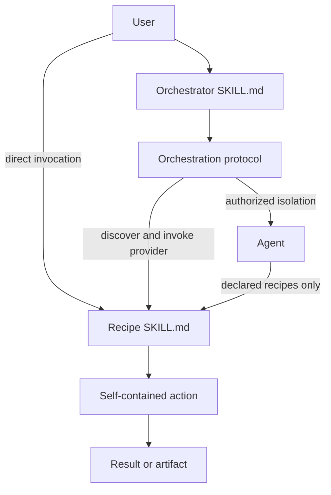

# Architecture

AIDD packages AI-assisted work into plugins, each owning one concern. This page is for contributors: where a capability belongs, and the rules that keep plugins independent. For the meaning of each term, see [Concepts](CONCEPTS.md).

## 🧩 Anatomy of a plugin

A plugin needs a manifest and skills. Everything else is optional. Locations are relative to the plugin directory.

| Component | Location |
| --- | --- |
| Manifest | `.claude-plugin/`, holding `plugin.json` |
| Skill | `skills/<name>/SKILL.md` |
| Actions | `skills/<name>/actions/` |
| Assets | `skills/<name>/assets/` |
| References | `skills/<name>/references/` |
| Agents | `agents/` |
| Commands | `commands/` |
| Hooks | `hooks/hooks.json` and the scripts beside it |
| MCP configuration | `.mcp.json` |
| Documentation | `README.md`, `CATALOG.md` (generated), `CHANGELOG.md` |

Project rules belong in the host's rules directory, such as `.claude/rules/`. `aidd-context` generates them as project context, outside the native Claude plugin surfaces.

## Responsibilities

Place each capability in the plugin whose concern owns it, and delegate to it from everywhere else.

| Plugin              | Concern              | Layer        |
| ------------------- | -------------------- | ------------ |
| `aidd-context`      | Knowledge production | Knowledge    |
| `aidd-pm`           | Product management   | Knowledge    |
| `aidd-refine`       | Meta-cognition       | Knowledge    |
| `aidd-dev`          | Code transformation  | Execution    |
| `aidd-vcs`          | Version control      | External     |
| `aidd-orchestrator` | Orchestration        | Coordination |
| `aidd-ui`           | UI/UX design         | Execution    |
| `aidd-telemetry`    | Measurement          | Observation  |
| `aidd-qa`           | Acceptance QA        | Execution    |

### Layers

| Layer | Boundary |
| --- | --- |
| Knowledge | Produces context and specifications. Never writes or runs application source. Context bootstrap creates no `package.json`. |
| Execution | Changes or validates application source. |
| External | Owns version control. |
| Coordination | Sequences artifacts (for example `INSTALL.md`). Domain logic and artifact contracts stay with their owners; direct and orchestrated calls obey the same contracts. |
| Observation | Records work without changing the observed artifacts. Productive flows never depend on it. |

`aidd-telemetry` counts the tokens of Claude Code and Codex sessions and attributes them to the task a person declared. The CLI reads, stores, attributes and reports; the plugin's hooks only ask, answer and record session facts. The contract is [`aidd_docs/product/usage-contract.md`](../aidd_docs/product/usage-contract.md).

## Execution model

| Role | Contract |
| --- | --- |
| Skill | The host loads `SKILL.md` on invocation. Work runs in the caller's context. |
| Orchestrator | Owns routing. Authorizes isolation or bounded fan-out. |
| Agent | Isolates work and returns a result. Invokes only declared canonical recipe skills. Never invokes orchestrators or reads skill files. |
| Recipe | Never invents spawning. An isolated recipe never delegates flow work. |
| Reconnaissance helper | Read-only. Neither mutates nor spawns. |
| Write path | At most two delegation layers, no cycles. |
| SDLC | Owns planning. [Delivery](../plugins/aidd-orchestrator/skills/01-sdlc/references/02-deliver.md) and [check](../plugins/aidd-orchestrator/skills/01-sdlc/references/03-check.md) govern execution, leaf executors, independent judgment and bounded repair. |

## 🪝 Bundled hooks

Dependency-free Node scripts declared in `hooks/hooks.json`. `node` must be on `PATH`. The table is generated from those files. Which tools run them: [Compatibility](COMPATIBILITY.md).

<!--hooks:start-->

| Plugin | Event | Runs |
| --- | --- | --- |
| [`aidd-context`](../plugins/aidd-context/README.md) | `SessionStart` | `hooks/update_memory.js` |
| [`aidd-telemetry`](../plugins/aidd-telemetry/README.md) | `SessionStart` · `UserPromptSubmit` | `hooks/session-start.cjs` · `hooks/catch-up.cjs` · `hooks/prompt-gate.cjs` |

<!--hooks:end-->

## Rules that keep plugins independent

| Rule | Held by |
| --- | --- |
| A skill links only inside its own directory. The tree ships both flat (each tool lays skills out in its own folders) and as a marketplace, and no relative path survives both. | `scripts/__tests__/a-skill-links-only-inside-itself.test.js` |
| A bundled script is named plugin-relative in backticks, never linked. | the same test |
| A capability is addressed as `/plugin:folder` or `@plugin:agent` only in dispatch tables (`## Actions`), orchestration references and agent permission lists (`# Skills you may invoke`). Elsewhere, name the responsibility. | `scripts/check-architecture-rules.js` |
| A recipe finds cross-plugin providers by description. An orchestrator verifies a plugin is installed before it dispatches to it. | review |
| Two exemptions exist: responsibility maps in `plugins/aidd-orchestrator/**`, and the onboarding menus in `plugins/aidd-context/skills/00-onboard/**`. The second ends once onboarding finds its providers at runtime. | `isExemptFromOrthogonality` in `scripts/lib/architecture-rules.js` |
| Tests for a bundled script live in `scripts/__tests__/`, never in the plugin, because `hooks/` is copied recursively into user projects. | review |
| The CLI writes only the capabilities a tool supports and warns about the rest. | The tool-support record in [Compatibility](COMPATIBILITY.md) |
| The CLI owns OpenCode's shared hook protocol. Plugins own the mapping of their own payloads. | [CLI architecture](../cli/ARCHITECTURE.md#hook-adaptation) |

## Related pages

[Maintainers guide](MAINTAINERS.md) for releases and adding a plugin. [CLI architecture](../cli/ARCHITECTURE.md) for translation and installation.
