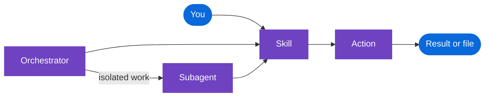

# Architecture

Where a capability belongs. For the terms, see [Concepts](CONCEPTS.md).

## Anatomy of a plugin

Only the manifest and the skills are required.

| Component | Location |
| --- | --- |
| Manifest | `.claude-plugin/`, holding `plugin.json` |
| Skill | `skills/<name>/SKILL.md` |
| Actions | `skills/<name>/actions/` |
| Assets | `skills/<name>/assets/` |
| References | `skills/<name>/references/` |
| Agents | `agents/` |
| Commands | `commands/` |
| Hooks | `hooks/hooks.json` and its scripts |
| MCP configuration | `.mcp.json` |
| Documentation | `README.md`, `CATALOG.md` (generated), `CHANGELOG.md` |

Project rules belong in your tool's rules directory, such as `.claude/rules/`. `aidd-context` generates them.

## Who owns what

Put each capability in the plugin that owns its concern. Every other plugin delegates to it.

| Plugin | Owns |
| --- | --- |
| `aidd-context` | Project knowledge: memory, context files, generators |
| `aidd-pm` | Product management: briefs, epics, stories, specs |
| `aidd-refine` | Thinking about the work: brainstorm, challenge, fact-check |
| `aidd-dev` | Code: plan, build, validate, review, debug |
| `aidd-vcs` | Version control: commits, pull requests, tags |
| `aidd-orchestrator` | Running other skills end to end |
| `aidd-ui` | UI and UX design |
| `aidd-qa` | Acceptance QA with video evidence |
| `aidd-telemetry` | Token measurement |

- `aidd-context`, `aidd-pm` and `aidd-refine` never write or run your application code.
- `aidd-telemetry` observes. No other flow depends on it.

## How a skill runs

| Role | Rule |
| --- | --- |
| Skill | Runs in the caller's context. Holds no logic, only its actions. |
| Orchestrator | Owns the routing. Decides what runs in isolation or in parallel. |
| Subagent | Returns only a result. Calls only the skills it declares. Never calls an orchestrator. |
| Delegation | At most two layers, no cycles. |

Rules that keep plugins independent

| Rule | Held by |
| --- | --- |
| A skill links only inside its own directory. The tree ships both flat (each tool lays skills out in its own folders) and as a marketplace, and no relative path survives both. | `scripts/__tests__/a-skill-links-only-inside-itself.test.js` |
| A bundled script is named plugin-relative in backticks, never linked. | the same test |
| A capability is addressed as `/plugin:folder` or `@plugin:agent` only in dispatch tables (`## Actions`), orchestration references and agent permission lists (`# Skills you may invoke`). Elsewhere, name the responsibility. | `scripts/check-architecture-rules.js` |
| A recipe finds cross-plugin providers by description. An orchestrator verifies a plugin is installed before it dispatches to it. | review |
| Two exemptions exist: responsibility maps in `plugins/aidd-orchestrator/**`, and the onboarding menus in `plugins/aidd-context/skills/00-onboard/**`. The second ends once onboarding finds its providers at runtime. | `isExemptFromOrthogonality` in `scripts/lib/architecture-rules.js` |
| Tests for a bundled script live in `scripts/__tests__/`, never in the plugin, because `hooks/` is copied recursively into user projects. | review |
| The CLI writes only the capabilities a tool supports and warns about the rest. | The tool-support record in [Compatibility](COMPATIBILITY.md) |
| The CLI owns OpenCode's shared hook protocol. Plugins own the mapping of their own payloads. | [CLI architecture](../cli/ARCHITECTURE.md#hook-adaptation) |

More: [Maintainers guide](MAINTAINERS.md), [CLI architecture](../cli/ARCHITECTURE.md).
