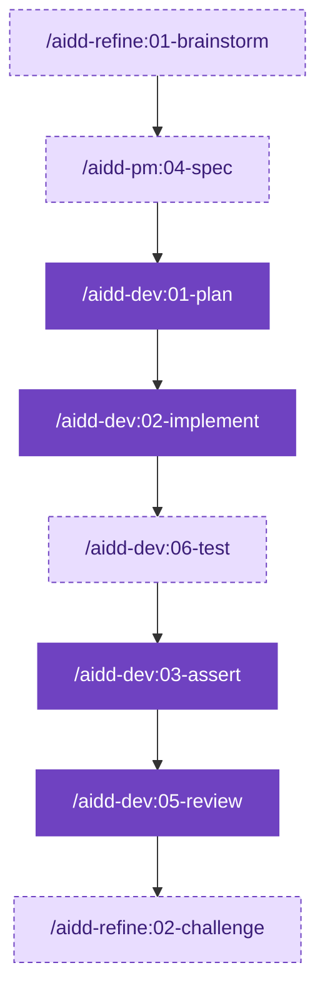
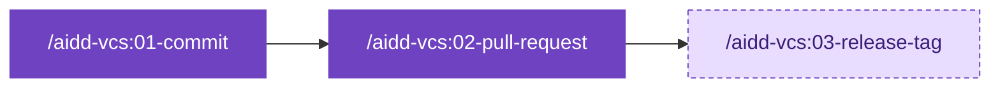
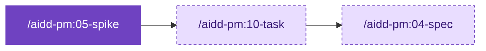
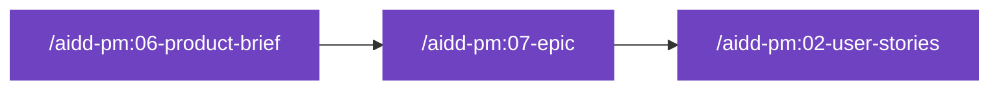

# Guides by goal

Pick your goal.

Run its skills in order.

Dashed boxes are optional.

## Start

| Goal | Run |
| --- | --- |
| Join an existing project | `/aidd-context:00-onboard` |
| Start a new project | `/aidd-context:01-bootstrap`, then `/aidd-context:02-project-memory` |
| See what is installed, or which skill fits | `/aidd-context:11-explore` |

## Build

### Make a small change

### Build a feature

- Brainstorm and spec help when the need is unclear.
- Challenge checks that the finished work answers the request.

### Fix a bug

- Debug reproduces the bug with a test, then fixes it.

### Refactor or harden code

### Commit and open a pull request

### Other ways to build

| Goal | Run |
| --- | --- |
| Run independent tasks in parallel | `/aidd-dev:10-batch` |
| Retry until a command passes | `/aidd-dev:09-for-sure` |

## Understand and decide

### Investigate a technical unknown

### Other ways to decide

| Goal | Run |
| --- | --- |
| Sharpen a vague idea | `/aidd-refine:01-brainstorm` |
| Find gaps in an idea, stories, a PRD or a spec | `/aidd-refine:03-shadow-areas` |
| Check the facts in a text | `/aidd-refine:04-fact-check` |
| Audit a codebase, read-only | `/aidd-dev:04-audit` |

## Plan the product

### Frame an opportunity

### Other ways to plan

| Goal | Run |
| --- | --- |
| Write a product requirements document | `/aidd-pm:03-prd` |
| Write a feature contract | `/aidd-pm:04-spec` |
| Refine an Epic or a Story | `/aidd-pm:08-three-amigos` |
| Read a ticket | `/aidd-pm:01-ticket-info` |
| Run the backlog | `/aidd-orchestrator:02-backlog` |

## Let the framework drive

| Goal | Run |
| --- | --- |
| Deliver a request end to end | `/aidd-orchestrator:01-sdlc` |
| Turn issues into pull requests without you | `/aidd-orchestrator:00-async-dev` |

- Start a request with `interactive` to approve the contract, the plan and the outcome.
- Do not replay the steps of `01-sdlc` by hand.

## Keep what you learn

| Goal | Run |
| --- | --- |
| Record a decision or a lesson | `/aidd-context:10-learn` |
| Create a skill | `/aidd-context:04-skill-generate` |
| Create a rule | `/aidd-context:05-rule-generate` |
| Create an agent | `/aidd-context:06-agent-generate` |
| Create a command | `/aidd-context:07-command-generate` |
| Create a hook | `/aidd-context:08-hook-generate` |
| Create something, kind unknown | `/aidd-context:03-context-generate` |
| Follow a how-to sheet | `/aidd-context:12-cook` |
| Improve how you work with the AI | `/aidd-refine:05-improve` |

Bundled how-to sheets: [MCP installation](../plugins/aidd-context/skills/12-cook/assets/recipes/mcp-installation.md), [token optimization](../plugins/aidd-context/skills/12-cook/assets/recipes/token-optimization.md), [the AIDDy mascot in the ChatGPT desktop app](../plugins/aidd-context/skills/12-cook/assets/recipes/install-aiddy-in-codex.md).

## Prove it works

| Goal | Run |
| --- | --- |
| Check a change in a browser, with video evidence | `/aidd-qa:01-acceptance-qa` |
| See what a task cost in tokens | `/aidd-telemetry:00-init`, then `/aidd-telemetry:01-usage` |

Token measurement is opt-in and local: see the [FAQ](FAQ.md#measurement). Every skill is described in the [catalog](CATALOG.md).
