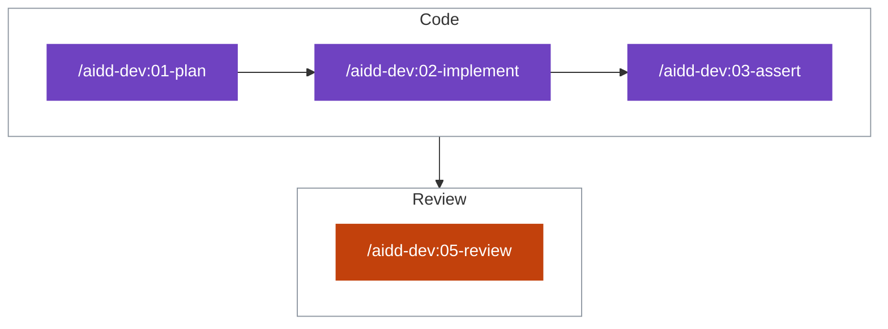
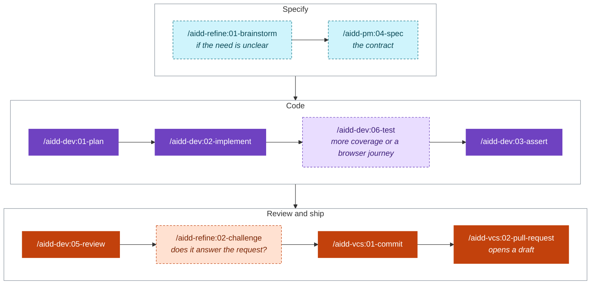
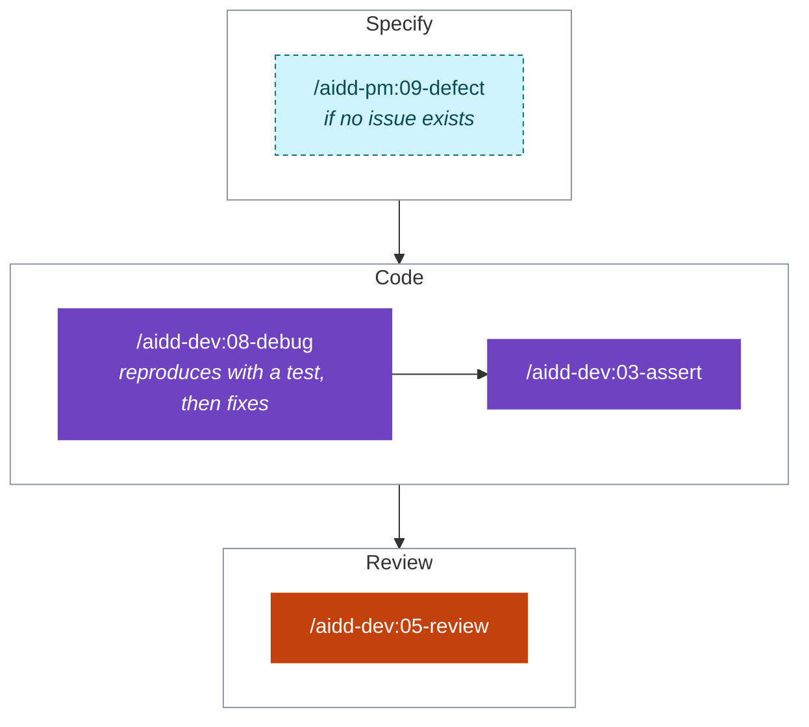
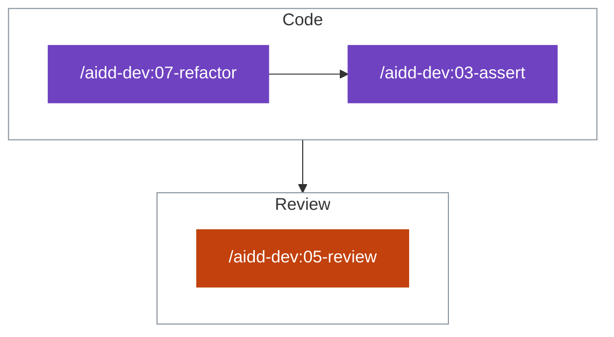
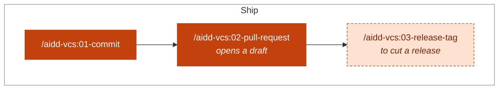
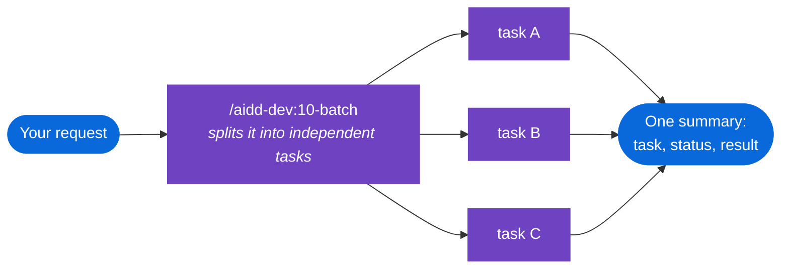
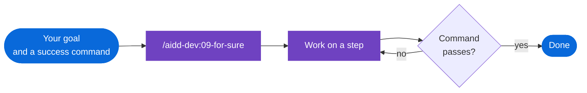
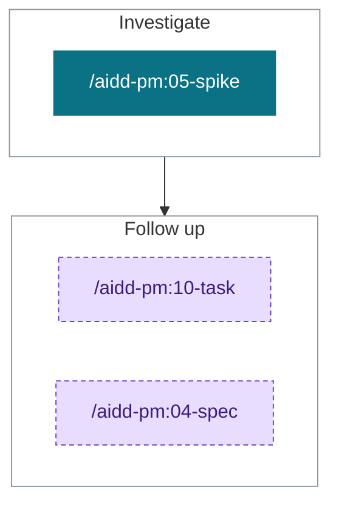
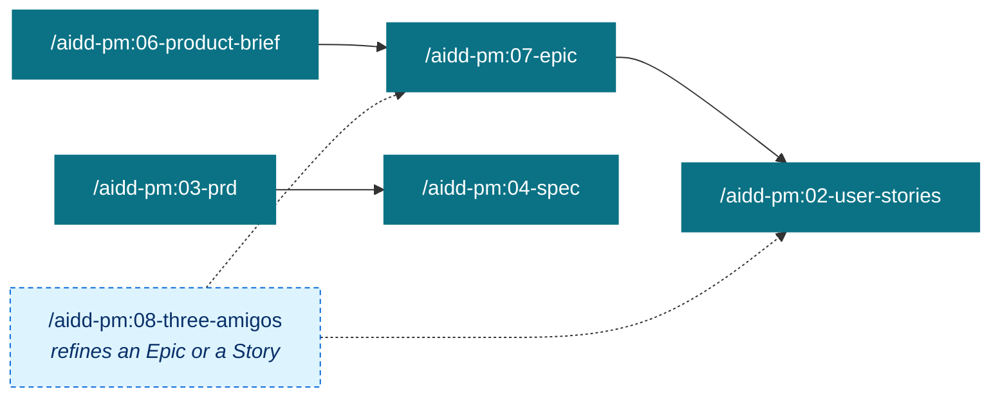

# Guides by goal

> [!TIP]
> Pick your goal and run its skills in order.
> Dashed boxes are optional.

## Start

| Goal | Run |
| --- | --- |
| Join an existing project | `/aidd-context:00-onboard` |
| Start a new project | `/aidd-context:01-bootstrap`, then `/aidd-context:02-project-memory` |
| See what is installed, or which skill fits | `/aidd-context:11-explore` |

## Build

### Make a small change

### Build a feature

### Fix a bug

### Refactor or harden code

### Commit and open a pull request

### Run tasks in parallel

### Retry until a command passes

## Understand and decide

### Investigate a technical unknown

### Other ways to decide

| Goal | Run |
| --- | --- |
| Sharpen a vague idea | `/aidd-refine:01-brainstorm` |
| Find gaps in an idea, stories, a PRD or a spec | `/aidd-refine:03-shadow-areas` |
| Check the facts in a text | `/aidd-refine:04-fact-check` |
| Audit a codebase, read-only | `/aidd-dev:04-audit` |

## Plan the product

### How the planning skills connect

| Goal | Run |
| --- | --- |
| Add a task, a defect or a spike to the backlog | `/aidd-pm:10-task`, `/aidd-pm:09-defect`, `/aidd-pm:05-spike` |
| Read a ticket | `/aidd-pm:01-ticket-info` |
| Triage, refine, order and check the backlog | `/aidd-orchestrator:02-backlog` |

## Let the framework drive

| Goal | Run |
| --- | --- |
| Deliver a request end to end | `/aidd-orchestrator:01-sdlc` |
| Turn issues into pull requests without you | `/aidd-orchestrator:00-async-dev` |

> [!NOTE]
> Start a request with `interactive` to approve the contract, the plan and the outcome.

## Learn and extend

| Goal | Run |
| --- | --- |
| Record a decision or a lesson | `/aidd-context:10-learn` |
| Follow a how-to sheet | `/aidd-context:12-cook` |
| Improve how you work with the AI | `/aidd-refine:05-improve` |

| Create | Run |
| --- | --- |
| A skill | `/aidd-context:04-skill-generate` |
| A rule | `/aidd-context:05-rule-generate` |
| An agent | `/aidd-context:06-agent-generate` |
| A command | `/aidd-context:07-command-generate` |
| A hook | `/aidd-context:08-hook-generate` |
| Something, kind unknown | `/aidd-context:03-context-generate` |

Bundled how-to sheets: [MCP installation](../plugins/aidd-context/skills/12-cook/assets/recipes/mcp-installation.md), [token optimization](../plugins/aidd-context/skills/12-cook/assets/recipes/token-optimization.md), [the AIDDy mascot in the ChatGPT desktop app](../plugins/aidd-context/skills/12-cook/assets/recipes/install-aiddy-in-codex.md).

## Prove it works

| Goal | Run |
| --- | --- |
| Check a change in a browser, with video evidence | `/aidd-qa:01-acceptance-qa` |
| Start counting tokens (opt-in, local) | `/aidd-telemetry:00-init` |
| See what a task cost in tokens | `/aidd-telemetry:01-usage` |

Every skill is described in the [catalog](CATALOG.md).
