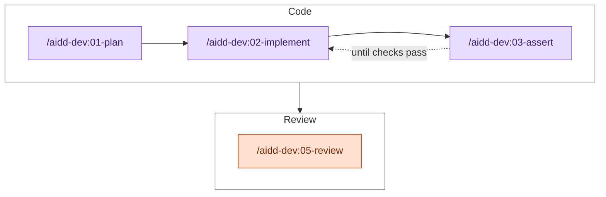
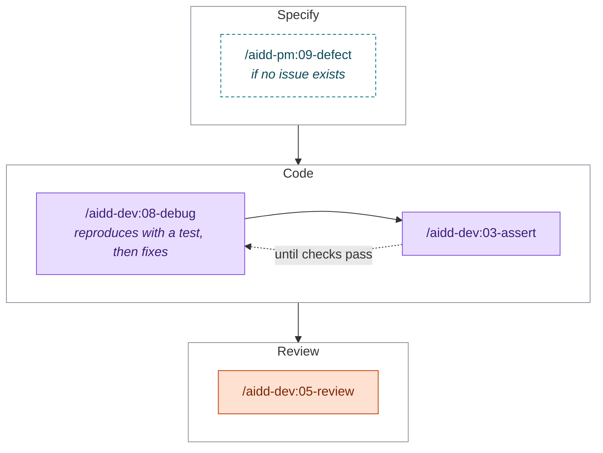
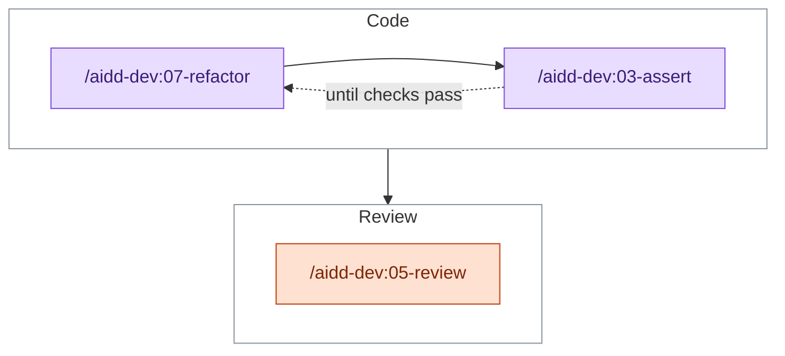
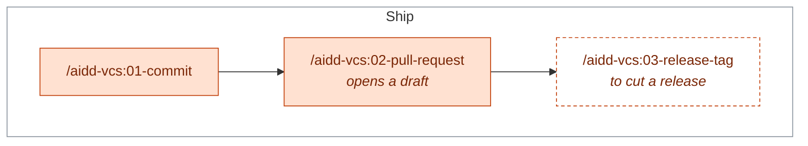
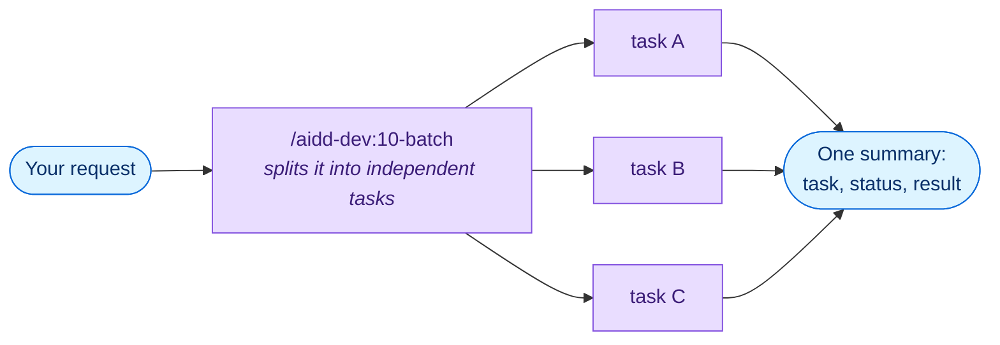
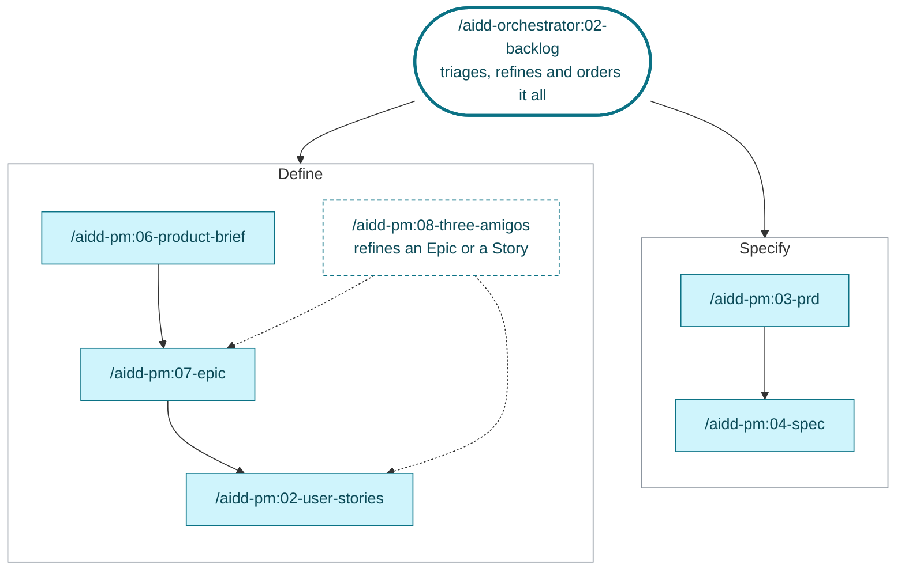

# Guides by goal

> [!TIP]
> Follow the steps in order, or jump to your goal.
> Dashed boxes are optional.

| Step | Goal |
| --- | --- |
| [1. Start](#1-start) | Join a project, start one, or look around |
| [2. Memory](#2-memory) | Give the AI a memory of the project |
| [3. Harness engineering](#3-harness-engineering) | Create your skills, rules, agents, commands and hooks |
| [4. Flows](#4-flows) | Build, fix, refactor, ship, plan, decide, verify |
| [5. Learn](#5-learn) | Keep what the work teaches you |
| [6. Update](#6-update) | Keep the memory and the plugins current |

## 1. Start

| Goal | Run |
| --- | --- |
| Join an existing project | `/aidd-context:00-onboard` |
| Start a new project | `/aidd-context:01-bootstrap` |
| See what is installed, or which skill fits | `/aidd-context:11-explore` |

## 2. Memory

| Goal | Run |
| --- | --- |
| Give the AI a memory of the project | `/aidd-context:02-project-memory setup` |

What it creates: [Concepts](CONCEPTS.md#project-memory).

## 3. Harness engineering

| Create | Run |
| --- | --- |
| A skill | `/aidd-context:04-skill-generate` |
| A rule | `/aidd-context:05-rule-generate` |
| An agent | `/aidd-context:06-agent-generate` |
| A command | `/aidd-context:07-command-generate` |
| A hook | `/aidd-context:08-hook-generate` |
| Something, kind unknown | `/aidd-context:03-context-generate` |
| Follow a how-to sheet | `/aidd-context:12-cook` |

Bundled how-to sheets:

- [Connect your services](../plugins/aidd-context/skills/12-cook/assets/recipes/connect-services.md)
- [Token optimization](../plugins/aidd-context/skills/12-cook/assets/recipes/token-optimization.md)
- [The AIDDy mascot in the ChatGPT desktop app](../plugins/aidd-context/skills/12-cook/assets/recipes/install-aiddy-in-codex.md)

## 4. Flows

### Build a feature

| Goal | Run |
| --- | --- |
| Deliver a request end to end | `/aidd-orchestrator:01-sdlc` |
| Turn issues into pull requests without you | `/aidd-orchestrator:00-async-dev` |
| Go step by step | The skills below, in order |

> [!NOTE]
> Delegate it all when you are sure of the task.
> Start the request with `interactive` to approve the contract, the plan and the outcome (yellow).

```mermaid
flowchart TD
  subgraph onboard["Onboarding"]
    direction TB
    start(["/aidd-context:00-onboard<br/>guides you through every step"])
    subgraph memory["Memory, once per project"]
      direction TB
      projectMemory["/aidd-context:02-project-memory"]
    end
    subgraph frame["Frame: write the contract"]
      direction TB
      request(["your request"]) --> ticket["/aidd-pm:01-ticket-info"] --> brainstorm["/aidd-refine:01-brainstorm"] --> spec["/aidd-pm:04-spec"] --> approveContract(["approve the contract"])
    end
    subgraph deliver["Deliver: build and validate"]
      direction TB
      plan["/aidd-dev:01-plan"] --> approvePlan(["approve the plan"]) --> implement["/aidd-dev:02-implement"] --> assert["/aidd-dev:03-assert"] --> commit["/aidd-vcs:01-commit"]
      assert -. "until checks pass" .-> implement
    end
    subgraph check["Check: independent review"]
      direction TB
      review["/aidd-dev:05-review"] --> challenge["/aidd-refine:02-challenge"] --> approveOutcome(["approve the outcome"]) --> pr["/aidd-vcs:02-pull-request"]
    end
    start --> memory --> frame --> deliver --> check
  end

  classDef skill fill:#e9ddff,stroke:#8250df,color:#3b1d78
  classDef opt fill:#fff,stroke:#8250df,stroke-dasharray:4 3,color:#3b1d78
  classDef you fill:#fff8c5,stroke:#9a6700,color:#633c01
  classDef entry fill:#fff,stroke:#8250df,stroke-width:3px,color:#3b1d78
  classDef plain fill:#eaeef2,stroke:#57606a,color:#24292f
  class projectMemory,spec,plan,implement,assert,commit,review,challenge,pr skill
  class ticket,brainstorm opt
  class approveContract,approvePlan,approveOutcome you
  class request plain
  class start entry
  style onboard fill:none,stroke:#8250df,stroke-width:2px
  style memory fill:none,stroke:#8c959f
  style frame fill:none,stroke:#8c959f
  style deliver fill:none,stroke:#8c959f
  style check fill:none,stroke:#8c959f
```

### Make a small change

### Fix a bug

### Refactor or harden code

### Commit and open a pull request

### Run tasks in parallel

### Plan the product

| Goal | Run |
| --- | --- |
| Add a task, a defect or a spike to the backlog | `/aidd-pm:10-task`, `/aidd-pm:09-defect`, `/aidd-pm:05-spike` |
| Read a ticket | `/aidd-pm:01-ticket-info` |

### Understand and decide

| Goal | Run |
| --- | --- |
| Investigate a technical unknown | `/aidd-pm:05-spike`, then `/aidd-pm:10-task` or `/aidd-pm:04-spec` |
| Sharpen a vague idea | `/aidd-refine:01-brainstorm` |
| Challenge finished work against its plan | `/aidd-refine:02-challenge` |
| Find gaps in an idea, stories, a PRD or a spec | `/aidd-refine:03-shadow-areas` |
| Check the facts in a text | `/aidd-refine:04-fact-check` |
| Audit a codebase, read-only | `/aidd-dev:04-audit` |

### Prove it works

| Goal | Run |
| --- | --- |
| Check a change in a browser, with video evidence | `/aidd-qa:01-acceptance-qa` |
| Start counting tokens (opt-in, local) | `/aidd-telemetry:00-init` |
| See what a task cost in tokens | `/aidd-telemetry:01-usage` |

## 5. Learn

| Goal | Run |
| --- | --- |
| Record a decision or a lesson | `/aidd-context:10-learn` |
| Review a finished conversation | `/aidd-refine:05-review-conversation` |

## 6. Update

| Goal | Run |
| --- | --- |
| Refresh the project memory | `/aidd-context:02-project-memory refresh` |
| Wire the memory into another tool | `/aidd-context:02-project-memory rewire` |
| Update the plugins | [Install guide](INSTALL.md#update) |

Every skill is described in the [catalog](CATALOG.md).
