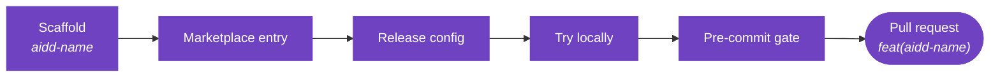

# Maintainers guide

How to run this repository day to day. For who may do what, see [Governance](../GOVERNANCE.md). For how contributors work, see [Contributing](../CONTRIBUTING.md).

## What you look after

| Thing | Where |
| --- | --- |
| Published plugins | `.claude-plugin/marketplace.json` and `plugins/` |
| Backlog and roadmap | [Project board](https://github.com/orgs/ai-driven-dev/projects/8), the single source of truth |
| Roles and access | GitHub teams `core-team`, `certified-members` and `trusted-partners` |
| Branch protection | `.github/rulesets/main.json`, applied as the "main protection" ruleset |
| Releases | release-please: `ci.yml` and `release-please-config.json` |
| Checks before a commit | `lefthook.yml` and `scripts/` |

## Every day

1. **Triage new issues.** They join the board on their own, and the form already set the type. Give each one a milestone or a priority, never both.
2. **Review pull requests.** Approve as a code owner, then squash-merge. The merge rules are in [Governance](../GOVERNANCE.md#code-decisions).
3. **Watch dependency updates.** Patch and minor bumps merge by themselves once checks pass. Review major bumps, then run `gh pr merge <n> --squash`.

## How work is tracked

One board, four axes. Only the status lives on the board.

| Axis | Answers | Values |
| --- | --- | --- |
| Type | What kind of work | `Bug`, `Feature`, `Task`, set by the issue form |
| Milestone | When it ships | One theme, due on a Thursday |
| Priority | In what order, for work with no date | `Urgent`, `High`, `Medium`, `Low` |
| Status | Where it stands | `Ideation`, `Todo`, `In Progress`, `In review`, `Done` |

- **A milestone or a priority, never both.** The milestone already says when.
- **The scope lives in the title**, as `feat(aidd-pm): ...`. Find work with `gh issue list --search 'aidd-pm in:title'`.
- **Status moves on its own** when an item is added (`Todo`), when a pull request is linked (`In review`), and when it is merged or closed (`Done`). `In Progress` is the one manual move.
- **Labels categorize nothing.** A label exists in [`.github/labels.yml`](../.github/labels.yml) only when a bot or a person reads it. Nothing syncs that file, so check it by hand:

```sh
diff <(gh label list --repo ai-driven-dev/framework | cut -f1 | sort) \
     <(yq e '.[].name' .github/labels.yml | sort)
```

## Release

The weekly release steps are in [Release](../RELEASE.md). Rules that matter to you:

- **Promote with a merge commit, never a squash or a rebase.** Use the **Promote next to main** workflow. A squash can leave a subject that fails `Commitlint`, which skips release-please. A rebase leaves a stale merge base, so every later back-merge conflicts.
- **The Release PR merges itself** with the App token, using `gh pr merge --merge --admin`.
- **Force a version** with `release-as` in `release-please-config.json`, and remove it after the release.
- **Hotfix:** merge with an empty description box, or `gh pr merge <n> --merge --body ""`. See [Release](../RELEASE.md#-hotfix) for why.

If a bad squash turns `main` red, an admin disables the "main protection" ruleset, force-pushes `main` back to the commit before the merge, re-enables the ruleset, and runs **Promote** again.

## Add a plugin



Adding a skill to an existing plugin? Generate it with `/aidd-context:03-context-generate` and add it to that plugin's `plugin.json`. You can skip the registration below.

1. **Scaffold.** Name it `aidd-<name>`, in lowercase. The layout, `plugin.json` and the `SKILL.md` and action format are in [Anatomy of a plugin](ARCHITECTURE.md#-anatomy-of-a-plugin).
2. **Register in the marketplace.** Add an entry to `.claude-plugin/marketplace.json` with `name`, `source` (`./plugins/aidd-<name>`), `strict: true` and `metadata: { "recommended": false }`. The last field keeps the plugin off the curated install path until it is stable.
3. **Register for release.** Add the package to `release-please-config.json` and to `.release-please-manifest.json`. Without both, it is never versioned.
4. **Try it locally.** Run `/plugin marketplace add ./` then `/plugin install aidd-<name>@aidd-framework`. Run `/reload-plugins` after each skill edit.
5. **Check.** Run `pnpm exec lefthook run pre-commit`. It validates JSON, YAML and frontmatter, and regenerates the plugin's `CATALOG.md`.
6. **Open a pull request** titled `feat(aidd-<name>): ...`. On merge, release-please tags and publishes it.

Writing rules: English, hyphens instead of em-dashes, no cross-plugin references in descriptions or READMEs, and one sentence per `Use when ... / Not for ...` cue. A skill's `name:` is its folder slug, such as `01-hello`, and it is invoked as `<plugin>:<folder>`.

## Branch protection and the bot

The policy (pull request only, code owner review, required checks) is in [Governance](../GOVERNANCE.md#code-decisions). The operations:

- Two actors can bypass the pull request rule, and neither can push straight to `main`: the **aidd-bot GitHub App**, whose token release-please and the Dependabot auto-merge use, and the organization's `admin` team, whose members can merge their own pull request. The team confers no role.
- The App's ID is in the secret `AIDD_BOT_APP_ID` and its key in `AIDD_BOT_PRIVATE_KEY`. If the App breaks, release and Dependabot pull requests stop merging. Fix the App rather than add an admin bypass.
- Head branches are not deleted on merge. The promotion PR uses a disposable `promote/next-to-main-<run>` branch that the workflow deletes. The back-merge runs unattended, and if it cannot push it opens an issue: resync with a `main` to `next` pull request. If `next` is missing, run `git push origin main:next`.
- To change protection, edit `.github/rulesets/main.json` (or `next.json`) first, then an admin applies it: `gh api -X PUT repos/ai-driven-dev/framework/rulesets/<id> --input .github/rulesets/main.json`. The file is the source, never the live ruleset.

## Security

- Vulnerabilities go through GitHub Security Advisories, never a public issue. See [`SECURITY.md`](../SECURITY.md).
- Secret scanning, push protection and Dependabot alerts are on. Push protection does not scan history, so never paste tokens.
- Runtime risks of one plugin, such as CI permissions or MCP servers, belong in that plugin's README.

## Do not edit by hand

- The generated blocks in the README, [`COMPATIBILITY.md`](COMPATIBILITY.md), [`ARCHITECTURE.md`](ARCHITECTURE.md) and the diagram images. Run `node scripts/sync-generated-docs.mjs`.
- The counts in the README, from `scripts/sync-readme-counts.mjs`.
- Each plugin's `CATALOG.md`, from `scripts/summarize-markdown.js`.

Both run through lefthook. The contributors image updates itself.
