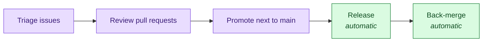

# Maintainers guide

- Who may do what: [Governance](../GOVERNANCE.md)
- How contributors work: [Contributing](../CONTRIBUTING.md)

## Your week

| Task | How |
| --- | --- |
| Triage | New issues join the board. Give each a milestone or a priority. |
| Review | Approve as a code owner, then squash-merge. Rules: [Governance](../GOVERNANCE.md#code-decisions). |
| Dependencies | Patch and minor bumps merge on their own. For a major bump, review it, then `gh pr merge <n> --squash`. |
| Promote | Run the **Promote next to main** workflow. Steps: [Release](../RELEASE.md). |

## Where things live

| Thing | Where |
| --- | --- |
| Plugins | `.claude-plugin/marketplace.json` and `plugins/` |
| Backlog and roadmap | [Project board](https://github.com/orgs/ai-driven-dev/projects/8) |
| Roles and access | GitHub teams `core-team`, `certified-members`, `trusted-partners` |
| Branch protection | `.github/rulesets/main.json` |
| Releases | `ci.yml` and `release-please-config.json` |
| Pre-commit checks | `lefthook.yml` and `scripts/` |
| Labels | `.github/labels.yml`, not synced: edit both by hand |

## Board fields

The board and its fields live on the GitHub Project, not in the repository.

| Field | Where | Answers | Values |
| --- | --- | --- | --- |
| Type | Issue | What kind | `Bug`, `Feature`, `Task` (set by the issue form) |
| Milestone | Repository | When | A theme |
| Priority | Project | In what order | `Urgent`, `High`, `Medium`, `Low` |
| Status | Project | Where it stands | `Ideation`, `Todo`, `In Progress`, `In review`, `Done` |

- A milestone or a priority, never both.
- The scope goes in the title: `feat(aidd-pm): ...`.

## Releases

| Rule | Why |
| --- | --- |
| Promote with a **merge commit** | A squash can fail `Commitlint` and skip the release. A rebase breaks the back-merge. |
| The Release PR merges itself | `gh pr merge --merge --admin`, with the bot token |
| Hotfix: merge with an empty description | Else release-please lists the change twice. See [Release](../RELEASE.md#-hotfix). |
| Force a version | `release-as` in `release-please-config.json`. Remove it after the release. |

If a bad squash turns `main` red, an admin:

1. Disables the "main protection" ruleset.
2. Force-pushes `main` back to the commit before the merge.
3. Re-enables the ruleset, and runs **Promote** again.

## Add to the framework

| I want to add | Run |
| --- | --- |
| A skill | `/aidd-context:04-skill-generate` |
| An agent | `/aidd-context:06-agent-generate` |
| A rule | `/aidd-context:05-rule-generate` |
| A command | `/aidd-context:07-command-generate` |
| A hook | `/aidd-context:08-hook-generate` |

## Create a plugin

1. Create `plugins/aidd-<name>/` ([layout](ARCHITECTURE.md#anatomy-of-a-plugin)).
2. Add it to `.claude-plugin/marketplace.json`, with `strict: true` and `metadata: { "recommended": false }`.
3. Add it to `release-please-config.json` and `.release-please-manifest.json`.
4. Try it: `/plugin marketplace add ./`, then `/plugin install aidd-<name>@aidd-framework`.
5. Run `pnpm exec lefthook run pre-commit`.
6. Open a pull request titled `feat(aidd-<name>): ...`.

## When protection or the bot breaks

| Case | Do |
| --- | --- |
| The `aidd-bot` App breaks | Release and Dependabot pull requests stop merging. Check its secrets `AIDD_BOT_APP_ID` and `AIDD_BOT_PRIVATE_KEY`. |
| Back-merge fails | It opens an issue. Resync with a `main` to `next` pull request. |
| `next` is missing | `git push origin main:next` |
| Change the protection | Edit `.github/rulesets/main.json`, then an admin runs `gh api -X PUT repos/ai-driven-dev/framework/rulesets/<id> --input .github/rulesets/main.json` |

## Do not edit by hand

| What | Generated by |
| --- | --- |
| Tables and plugin cards in the README, `COMPATIBILITY.md`, `CATALOG.md` | `node scripts/sync-generated-docs.mjs` |
| Counts in the README | `scripts/sync-readme-counts.mjs` |
| Each plugin's `CATALOG.md` | `scripts/summarize-markdown.js` |

Vulnerabilities: GitHub Security Advisories, never a public issue. See [`SECURITY.md`](../SECURITY.md).
