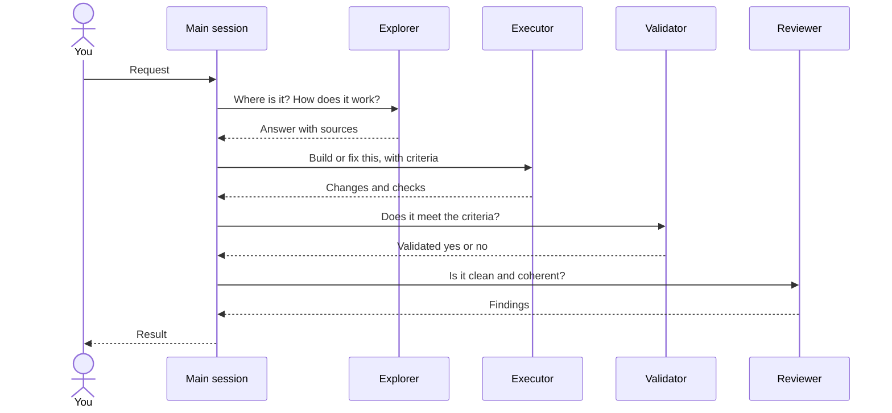

# 🤝 Subagents

Four generic agents your AI tool can hand work to, each in a fresh context. They ship with the `aidd-orchestrator` plugin; the skill that calls one gives it its concern, so the same executor writes code under `aidd-dev` and a spec under `aidd-pm`.

## 📑 Contents

- [How it works](#-how-it-works)
- [Which agent for which task](#-which-agent-for-which-task)
- [Install](#-install)
- [Models](#-models)
- [Limits](#-limits)

## 🔀 How it works

Your main session keeps the conversation and decides what to delegate. Each agent gets a scoped brief, works in its own context, and returns its result to the main session, which owns the final answer.



Each step is optional: the main session calls only the agents the task needs, and repeats execution when validation or review finds a gap.

Only `/aidd-orchestrator:01-sdlc` names an agent, by its role (`validator`), so a run delegates the same way every time; other workflows ask for a responsibility. The host resolves the role to its install, `aidd-orchestrator:validator` from the Claude Code marketplace or `aidd-orchestrator-validator` in a project distribution, or gives the brief to its default subagent when the agent is not installed.

## 🧭 Which agent for which task

| Agent | Use it to | It returns | Writes files, by instruction |
| --- | --- | --- | --- |
| [Explorer](../plugins/aidd-orchestrator/agents/explorer.md) | Find files and symbols, trace a flow, answer a codebase question before a change | The answer, with sources and unknowns | No |
| [Executor](../plugins/aidd-orchestrator/agents/executor.md) | Write or fix code and docs within a defined scope, then verify them | `COMPLETE`, `INCOMPLETE` or `BLOCKED`, with changes and checks run | Yes |
| [Validator](../plugins/aidd-orchestrator/agents/validator.md) | Confirm delivered work meets the request and its acceptance criteria | `Validated: yes` or `no`, with what failed | No; runs checks |
| [Reviewer](../plugins/aidd-orchestrator/agents/reviewer.md) | Find defects, contradictions, duplication and needless complexity in finished work | `no actionable findings`, `changes needed` or `insufficient evidence`, with findings | No |

## 📦 Install

Install the `aidd-orchestrator` plugin: `/plugin install aidd-orchestrator@aidd-framework` in Claude Code, or see the [quick start](../README.md#-quick-start) for the other tools. The agents come with it, except as a Codex plugin (see [Limits](#-limits)); open a new session so the tool loads them.

## 🧠 Models

The plugin ships no model, so an agent runs on the model of the session that called it until you pick a provider. [`agent-models.json`](../cli/src/contexts/tools/domain/formats/agent-models.json) then gives each piece of work a tier:

| Tier | Runs | At openai | At anthropic | At mistral |
| --- | --- | --- | --- | --- |
| `smart` | the main session, with `--main` | `gpt-6.1-sol` | `claude-opus-5-5` | `mistral-large-4` |
| `standard` | the reviewer | `gpt-6.1-sol` | `claude-sonnet-5-5` | `mistral-medium-latest` |
| `light` | the explorer, executor and validator | `gpt-6-luna` | `claude-haiku-5-5` | `mistral-small-latest` |

```bash
aidd agents set-model mistral --ide opencode --main   # agents and this project's main session
aidd agents set-model anthropic --ide claude --global --main   # main session in ~/.claude
aidd agents unset-model --ide opencode,claude   # back to the session's model, main restored
aidd setup --ide opencode --provider mistral   # the same choice, at install time
```

The provider is chosen per IDE for the whole machine, like the built framework the agents ship in: every install that builds it applies it, and `set-model` re-installs this project's plugins at once. `--main` writes the `smart` model into the IDE's own settings, this project's or, with `--global`, yours, and records what it replaced so `unset-model` restores it. A model an agent declares itself is kept.

| Host | Providers | Agent written as | Main session |
| --- | --- | --- | --- |
| Claude Code | anthropic | `model`, `effort` | `.claude/settings.json`: `model`, `effortLevel` |
| Codex | openai | `model`, `model_reasoning_effort` | `.codex/config.toml`: `model`, `model_reasoning_effort` |
| Copilot | openai, anthropic | `model`, `reasoningEffort` | none |
| OpenCode | openai, anthropic, mistral | `model: <provider>/<model>#<effort>` | `opencode.json`: `model` |
| Cursor | anthropic | `model: <model>[effort=<effort>]` | none |
| Kilo | openai, anthropic, mistral | `model: <provider>/<model>`, `variant` | none |

## 🚧 Limits

- **Tools:** every agent inherits the calling session's tools and permissions; what it writes is an instruction, not a restriction.
- **Codex:** a Codex plugin cannot carry agents, so only the flat distribution installs them, in `.codex/agents/`. Codex loads them only in a trusted project.
- **Models:** OpenCode V1 reads the same file but not the `#<effort>` variant. A host installing straight from the marketplace (`/plugin install`) pins no model; only an install through `aidd` does. Another project picks up a changed provider at its next `aidd update` or `aidd plugin update`.
- **Machine-wide installs:** `aidd setup --global` registers the framework machine-wide but installs no plugin yet, so `make reload` still installs them itself, without models.
- **Updates:** reinstalling replaces the agents still shipped; one removed from the plugin stays where a copy put it until you delete it.

Sources: [Claude Code sub-agents](https://code.claude.com/docs/en/sub-agents), [Copilot custom agents](https://docs.github.com/en/copilot/reference/custom-agents-configuration), [OpenCode agents](https://opencode.ai/v2/docs/agents), [Codex subagents](https://developers.openai.com/codex/subagents), [Cursor subagents](https://cursor.com/docs/subagents).
