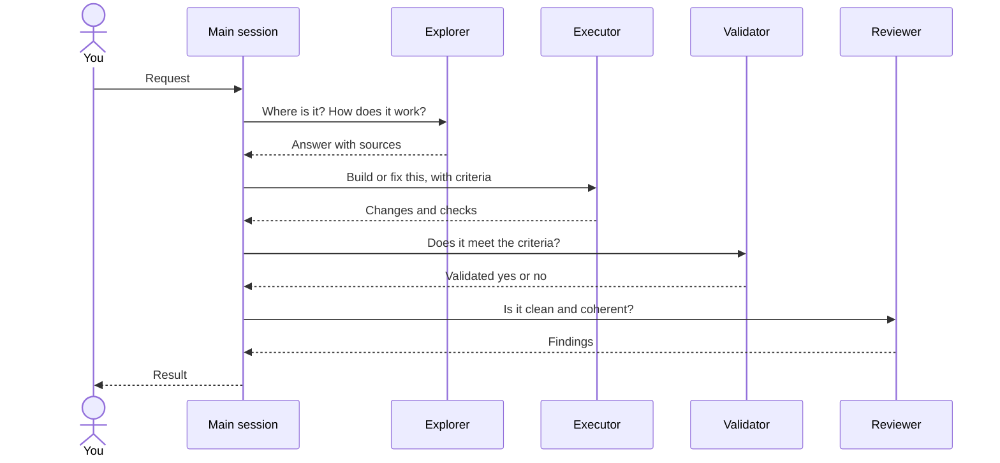

# 🤝 Subagents

Four generic agents your AI tool can hand work to, each in a fresh context. They ship with the `aidd-orchestrator` plugin; the skill that calls one gives it its concern, so the same executor writes code under `aidd-dev` and a spec under `aidd-pm`.

## 📑 Contents

- [How it works](#-how-it-works)
- [Which agent for which task](#-which-agent-for-which-task)
- [Install](#-install)
- [Models](#-models)
- [Limits](#-limits)

## 🔀 How it works

Your main session keeps the conversation and decides what to delegate. Each agent gets a scoped brief, works in its own context, and returns its result to the main session, which owns the final answer.

Each step is optional: the main session calls only the agents the task needs, and repeats execution when validation or review finds a gap.

Delegation is by responsibility: workflows such as `/aidd-orchestrator:01-sdlc` ask for "a fresh validation agent", and the host picks one of these if installed, or its default subagent otherwise. No workflow names an agent, because the name changes with the install: `aidd-orchestrator:validator` from the Claude Code marketplace, `aidd-orchestrator-validator` in a project distribution.

## 🧭 Which agent for which task

| Agent | Use it to | It returns | Writes files, by instruction |
| --- | --- | --- | --- |
| [Explorer](../plugins/aidd-orchestrator/agents/explorer.md) | Find files and symbols, trace a flow, answer a codebase question before a change | The answer, with sources and unknowns | No |
| [Executor](../plugins/aidd-orchestrator/agents/executor.md) | Write or fix code and docs within a defined scope, then verify them | `COMPLETE`, `INCOMPLETE` or `BLOCKED`, with changes and checks run | Yes |
| [Validator](../plugins/aidd-orchestrator/agents/validator.md) | Confirm delivered work meets the request and its acceptance criteria | `Validated: yes` or `no`, with what failed | No; runs checks |
| [Reviewer](../plugins/aidd-orchestrator/agents/reviewer.md) | Find defects, contradictions, duplication and needless complexity in finished work | `no actionable findings`, `changes needed` or `insufficient evidence`, with findings | No; only the review report a workflow asks for |

## 📦 Install

Install the `aidd-orchestrator` plugin: `/plugin install aidd-orchestrator@aidd-framework` in Claude Code, or see the [quick start](../README.md#-quick-start) for the other tools. The agents come with it, except as a Codex plugin (see [Limits](#-limits)); open a new session so the tool loads them.

## 🧠 Models

No model is pinned. Each host applies its own default for subagents, usually the model of the session that called them. A model you declare in an agent reaches every host as written; only Codex drops a Claude selector such as `opus`.

## 🚧 Limits

- **Tools:** every agent inherits the calling session's tools and permissions; what it writes is an instruction, not a restriction.
- **Codex:** a Codex plugin cannot carry agents, so only the flat distribution installs them, in `.codex/agents/`. Codex loads them only in a trusted project.
- **Updates:** reinstalling replaces the agents still shipped; one removed from the plugin stays where a copy put it until you delete it.

Sources: [Claude Code sub-agents](https://code.claude.com/docs/en/sub-agents), [Copilot custom agents](https://docs.github.com/en/copilot/reference/custom-agents-configuration), [OpenCode agents](https://opencode.ai/v2/docs/agents), [Codex subagents](https://developers.openai.com/codex/subagents), [Cursor subagents](https://cursor.com/docs/subagents).
