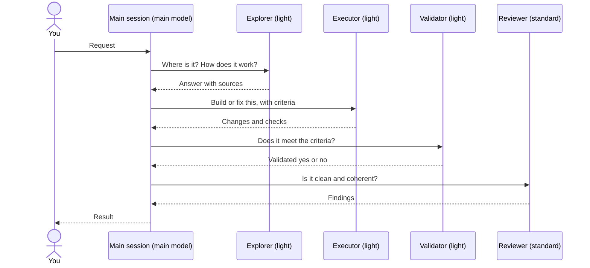

# 🤝 Optional subagents (beta)

Four specialist agents your AI tool can hand work to, each in a fresh context and on a model sized for the job. Plugins work without them; you install them explicitly.

## 📑 Contents

- [How it works](#-how-it-works)
- [Which agent for which task](#-which-agent-for-which-task)
- [Install](#-install)
- [Models](#-models)
- [Update or remove](#-update-or-remove)
- [Limits](#-limits)

## 🔀 How it works

Your main session keeps the conversation and decides what to delegate. Each agent gets a scoped brief, works in its own context, and returns its result to the main session, which owns the final answer.



Each step is optional: the main session calls only the agents the task needs, and repeats execution when validation or review finds a gap.

Delegation is by responsibility: workflows such as `/aidd-orchestrator:01-sdlc` ask for "a fresh validation agent", and the host picks one of these if installed, or a general-purpose agent otherwise.

## 🧭 Which agent for which task

| Agent | Use it to | It returns | Changes files |
| --- | --- | --- | --- |
| [Explorer](../cli/assets/agents/explorer.md) | Find files and symbols, trace a flow, answer a codebase question before a change | The answer, with sources and unknowns | No |
| [Executor](../cli/assets/agents/executor.md) | Write or fix code and docs within a defined scope, then verify them | `COMPLETE`, `INCOMPLETE` or `BLOCKED`, with changes and checks run | Yes |
| [Validator](../cli/assets/agents/validator.md) | Confirm delivered work meets the request and its acceptance criteria | `Validated: yes` or `no`, with what failed | No |
| [Reviewer](../cli/assets/agents/reviewer.md) | Find defects, contradictions, duplication and needless complexity in finished work | `no actionable findings`, `changes needed` or `insufficient evidence`, with findings | No |

## 📦 Install

The command is not released yet; build it from a framework checkout:

```sh
pnpm --dir cli install --frozen-lockfile
pnpm --dir cli build
```

Then pick your IDE and provider:

```sh
# In one project (from its root)
node /path/to/framework/cli/dist/cli.js agents install --ide claude-code --provider anthropic

# For every project of this user
node /path/to/framework/cli/dist/cli.js agents install --ide claude-code --provider anthropic --scope user

# Also set the main session model (optional)
node /path/to/framework/cli/dist/cli.js agents install --ide claude-code --provider anthropic --main
```

Open a new session afterwards so the IDE loads them.

| IDE (`--ide`) | Providers | Project | `--scope user` | `--main` |
| --- | --- | --- | --- | --- |
| `claude-code` | anthropic | `.claude/agents/` | `~/.claude/agents/` | yes |
| `codex` | openai | `.codex/agents/` | `~/.codex/agents/` | yes |
| `opencode` | openai, anthropic, mistral | `.opencode/agents/` | `~/.config/opencode/agents/` | yes |
| `copilot` | openai, anthropic | `.github/agents/` | `~/.copilot/agents/` | no |
| `cursor` | anthropic | `.cursor/agents/` | no | no |

User paths follow `CLAUDE_CONFIG_DIR`, `CODEX_HOME`, `XDG_CONFIG_HOME` and `COPILOT_HOME`. AIDD records what it wrote in `.aidd/agents.json` (user scope: AIDD's user config directory) and never overwrites a file you edited.

## 🧠 Models

Each role uses a profile; each provider sets the profile's model and effort in [agent-models.json](../cli/src/contexts/tools/domain/formats/agent-models.json).

| Profile | Roles | Anthropic | OpenAI | Mistral (OpenCode) |
| --- | --- | --- | --- | --- |
| `main` | main session, with `--main` | Opus 5.5 | GPT-6.1 Sol | Large 4 |
| `standard` | reviewer | Sonnet 5.5 | GPT-6.1 Sol | Medium (`-latest`) |
| `light` | explorer, executor, validator | Haiku 5.5 | GPT-6 Luna | Small (`-latest`) |

`light` saves cost; change the role mapping in that file to trade cost for quality.

`--main` writes only these keys and keeps the rest of the file:

| IDE | File | Keys |
| --- | --- | --- |
| Claude Code | `.claude/settings.json` | `model`, `effortLevel` |
| Codex | `.codex/config.toml` | `model`, `model_reasoning_effort`; a selected `profile` still wins |
| OpenCode | `opencode.json` | `model` (OpenCode keeps no effort at that level); refused when `opencode.jsonc` holds the settings |

It records the previous values in `.aidd/main-model.json` and restores them on removal; it refuses a value you changed since, and TOML it cannot edit safely.

## 🔄 Update or remove

- **Update:** rerun the same install command; unmodified agents are refreshed and retired roles removed.
- **Remove:** `agents remove --ide <ide>` (add `--scope user` for user agents).
- **Clean:** `aidd clean` removes project agents with the rest of AIDD; user agents stay until `agents remove --scope user`.

**Framework contributors:** `make reload` runs `agents install --scope user` for each IDE in [reload-agents.json](../scripts/reload-agents.json), adding `--main` where `"main": true`, so it also sets your main model. Point `RELOAD_AGENTS` at another file to change that. The file only adds: undo with `agents remove --scope user --ide <ide>`.

## 🚧 Limits

- **Runtime model:** the files set model and effort; your plan or account decides what actually runs. A Copilot account limited to `auto` ignores the configured model with a warning.
- **Cursor user scope:** Cursor CLI 2026.10.19 loaded no agent from `~/.cursor/agents/`, so only project install is supported.
- **Codex:** project files load only for trusted projects; agents inherit the parent session's service tier, so Fast is enabled with `/fast` in the parent ([speed](https://learn.chatgpt.com/docs/agent-configuration/speed)).
- **Interrupted command:** check the files before deleting `.aidd/agents.json.lock`; a handled failure already restores files and registries.

Check loading with `pnpm --dir cli test:e2e:agents`: it installs the agents in a throwaway project and asks each installed host which ones it loaded.

Sources: [Claude Code sub-agents](https://code.claude.com/docs/en/sub-agents) and [settings](https://code.claude.com/docs/en/settings), [Codex subagents](https://developers.openai.com/codex/subagents) and [config](https://developers.openai.com/codex/config-reference), [OpenCode agents](https://opencode.ai/docs/agents) and [models](https://opencode.ai/v2/docs/models#variants), [Copilot configuration directory](https://docs.github.com/en/copilot/reference/copilot-cli-reference/cli-config-dir-reference) and [model IDs](https://docs.github.com/en/copilot/reference/copilot-cli-reference/cli-command-reference#supported-models), [Cursor subagents](https://cursor.com/docs/subagents), [Claude models](https://platform.claude.com/docs/en/models/overview), [OpenAI models](https://developers.openai.com/api/docs/models), [Mistral models](https://docs.mistral.ai/models), [Mistral Large 4](https://docs.mistral.ai/models/mistral-large-4-0), [Mistral reasoning](https://docs.mistral.ai/studio/conversations/reasoning). Mistral Large 4 and Medium 3.5 are public previews; `mistral-large-latest` still pointed to Large 3, without reasoning, so the main model is pinned.
