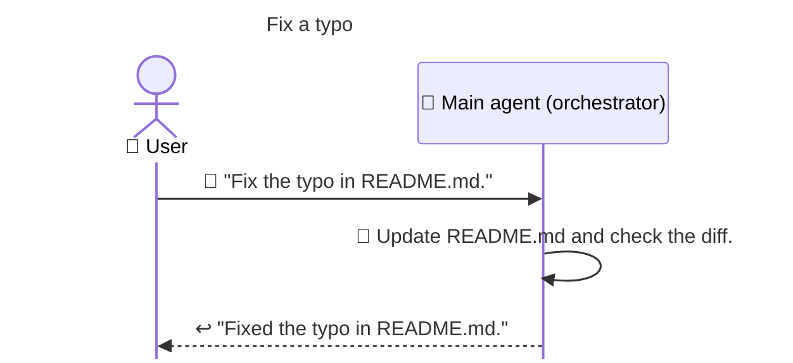
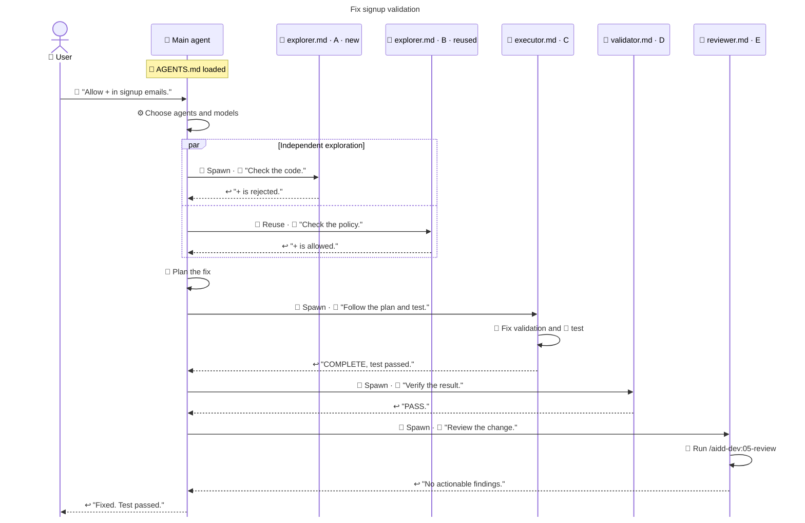

# 🤝 Subagents

Four generic agents your AI tool can hand work to. They ship with the `aidd-orchestrator` plugin and receive their task from the caller.

## 📑 Contents

- [How it works](#-how-it-works)
- [Which agent for which task](#-which-agent-for-which-task)
- [Install](#-install)
- [Models](#-models)
- [Limits](#-limits)
- [Decisions](#-decisions)

## 🔀 How it works

The main agent is the conversation window. It loads the host's project instructions, such as [`AGENTS.md` in Codex](https://developers.openai.com/codex/guides/agents-md), and owns the outcome. What subagents receive depends on the host and configuration.

The main agent chooses whether delegation helps. These examples and responses are hypothetical.

### A simple request

When delegation would add overhead, the main agent can handle the request itself.



### Test the four agents

Run this single prompt from the framework repository. The full test takes six runs and consumes more tokens than one pair.

```text
Compare the same task in two isolated worktrees at the same commit:
1. Main agent alone, without subagents.
2. Main agent with explorer, executor, validator and reviewer, using gpt-6-luna at high effort when supported.

Keep the main model and its effort identical. Use fresh sessions and run the worktrees sequentially. Repeat for three pairs, alternate which variant runs first, and report medians and cache conditions.

Task: Improve scripts/check-markdown-links.js so Markdown links with angle-bracket targets, such as [guide](<docs/my guide.md>), are checked correctly. Preserve the handling of HTML and existing links. Update the help text and add meaningful tests in scripts/__tests__/check-markdown-links.test.js.

In the delegated run:
- Explorer investigates the checker and tests.
- The main agent prepares a plan; executor implements and verifies it.
- Validator independently verifies the outcome; reviewer examines the diff for defects.
- Repair any confirmed gaps and check again.

In the solo run, do the equivalent work directly. In both runs, execute the relevant tests and leave the changes uncommitted.

Report for each run: models and effort, elapsed time, parent and child input, cached input and output tokens, checks, and findings. Sum each agent's usage once and do not double-count cached input. Compare the outcomes against the same requirements. Report missing measurements and cache conditions; do not invent costs. Preserve the diffs for review and clean up temporary files.
```

This compares complete workflows. Per-agent usage is measurable, but attributing a gain to one agent needs separate tests.

### A request with subagents

This example shows one successful flow. Explorer A is new and Explorer B is reused; their independent tasks run in parallel.



## 🧭 Which agent for which task

| Agent | Use it to | It returns | Writes files, by instruction |
| --- | --- | --- | --- |
| [Explorer](../plugins/aidd-orchestrator/agents/explorer.md) | Distill substantial code, documentation, service or web research into sourced findings | The answer, with sources and unknowns | No |
| [Executor](../plugins/aidd-orchestrator/agents/executor.md) | Implement a provided plan when delegation is worthwhile; verify changes and request review when uncertain | `COMPLETE`, `INCOMPLETE` or `BLOCKED`, with changes and checks run | Yes |
| [Validator](../plugins/aidd-orchestrator/agents/validator.md) | Independently verify an outcome, service, configuration or data change | `PASS`, `FAIL` or `BLOCKED`, with evidence | No; runs checks |
| [Reviewer](../plugins/aidd-orchestrator/agents/reviewer.md) | Review implemented work after a plan or when the executor has a concern | `no actionable findings`, `changes needed` or `insufficient evidence`, with findings | No; only the review report a workflow asks for |

## 📦 Install

Install the `aidd-orchestrator` plugin: `/plugin install aidd-orchestrator@aidd-framework` in Claude Code, or see [installation](INSTALL.md) for the other tools. The agents come with it, except as a Codex plugin (see [Limits](#-limits)); open a new session so the tool loads them.

For every project on the machine at once:

```bash
aidd setup --global --ide claude,codex,copilot,cursor,kilo,opencode --plugins all
aidd sync --global   # after a framework update
```

## 🧠 Models

The shipped agents do not pin a model. Hosts apply their defaults unless a model is configured for an agent; support varies by host.

## 🚧 Limits

- **Tools:** agents use tools available under their host permissions; prompt text alone does not restrict tools.
- **Codex:** a Codex plugin cannot carry agents, so the flat distribution installs them in `.codex/agents/`. Codex loads them only in a trusted project; `aidd setup --global` installs them in `~/.codex/agents/` instead.
- **Models:** OpenCode V1 reads the same file but not the `#<effort>` variant.
- **Updates:** reinstalling replaces the agents still shipped; one removed from the plugin stays where a copy put it until you delete it.

Sources: [Claude Code sub-agents](https://code.claude.com/docs/en/sub-agents), [Copilot custom agents](https://docs.github.com/en/copilot/reference/custom-agents-configuration), [OpenCode agents](https://opencode.ai/v2/docs/agents), [Codex subagents](https://developers.openai.com/codex/subagents), [Cursor subagents](https://cursor.com/docs/subagents).

## 📝 Decisions
Those are the decisions we made during the configuration of the agents.

### Instructions

- Define behaviors explicitly; use personas only when useful.
- **Simplicity first:** minimize work and output while preserving reliability; avoid over-engineering.
- **Independent judgment:** think before acting, challenge weak ideas, and avoid sycophancy. Advise proactively when it matters.
- **Autonomy:** reuse information and authorization, verify before asking, and report unresolved work.
- **Communication:** use the fewest words without losing meaning; prefer short bullets and no em dashes.
- **Files:** keep durable information current, avoid unnecessary files, and clean up temporary ones.

### Subagents

- The main agent owns decisions and outcomes; handle small tasks directly. Use the executor for a provided plan when delegation is worthwhile, not for a micro change.
- Delegate substantial research to the explorer, planned implementation to the executor, independent verification to the validator, and review to the reviewer.
- Run independent tasks in parallel only when the benefit exceeds coordination costs.
- Choose the simplest suitable model and effort; stronger reasoning may be needed for harder tasks.
- Delegate to protect focus or gain speed or independent verification, not on the assumption that it saves tokens.
