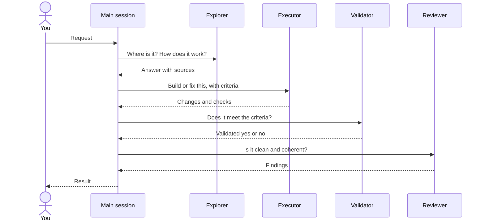

# 🤝 Subagents

Four generic agents your AI tool can hand work to, each in a fresh context. They ship with the `aidd-orchestrator` plugin; the skill that calls one gives it its concern, so the same executor writes code under `aidd-dev` and a spec under `aidd-pm`.

## 📑 Contents

- [How it works](#-how-it-works)
- [Which agent for which task](#-which-agent-for-which-task)
- [Install](#-install)
- [Models](#-models)
- [Limits](#-limits)

## 🔀 How it works

Your main session keeps the conversation and decides what to delegate. Each agent gets a scoped brief, works in its own context, and returns its result to the main session, which owns the final answer.



Each step is optional: the main session calls only the agents the task needs, and repeats execution when validation or review finds a gap.

Only `/aidd-orchestrator:01-sdlc` names an agent, by its role (`validator`), so a run delegates the same way every time; other workflows ask for a responsibility. The host resolves the role to its install, `aidd-orchestrator:validator` from the Claude Code marketplace or `aidd-orchestrator-validator` in a project distribution, or gives the brief to its default subagent when the agent is not installed.

## 🧭 Which agent for which task

| Agent | Use it to | It returns | Writes files, by instruction |
| --- | --- | --- | --- |
| [Explorer](../plugins/aidd-orchestrator/agents/explorer.md) | Find files and symbols, trace a flow, answer a codebase question before a change | The answer, with sources and unknowns | No |
| [Executor](../plugins/aidd-orchestrator/agents/executor.md) | Write or fix code and docs within a defined scope, then verify them | `COMPLETE`, `INCOMPLETE` or `BLOCKED`, with changes and checks run | Yes |
| [Validator](../plugins/aidd-orchestrator/agents/validator.md) | Confirm delivered work meets the request and its acceptance criteria | `Validated: yes` or `no`, with what failed | No; runs checks |
| [Reviewer](../plugins/aidd-orchestrator/agents/reviewer.md) | Find defects, contradictions, duplication and needless complexity in finished work | `no actionable findings`, `changes needed` or `insufficient evidence`, with findings | No; only the review report a workflow asks for |

## 📦 Install

Install the `aidd-orchestrator` plugin: `/plugin install aidd-orchestrator@aidd-framework` in Claude Code, or see the [quick start](../README.md#quick-start) for the other tools. The agents come with it, except as a Codex plugin (see [Limits](#-limits)); open a new session so the tool loads them.

For every project on the machine at once:

```bash
aidd setup --global --ide claude,codex,copilot,cursor,kilo,opencode --plugins all
aidd sync --global   # after a framework update
```

## 🧠 Models

The main session and the agents run on the IDE's model unless you pick a provider when installing:

```bash
aidd setup --ide opencode --provider mistral   # main session and agents on Mistral models
aidd setup --ide opencode --provider none      # back to the IDE's model
aidd setup --global --ide codex,opencode --plugins all --provider openai   # every project
```

| Tier | Runs | openai | anthropic | mistral |
| --- | --- | --- | --- | --- |
| smart | Reviewer | `gpt-6.1-sol` | `claude-opus-5-5` | `mistral-large-4` |
| standard | Main session | `gpt-6.1-terra` | `claude-sonnet-5-5` | `mistral-large-4` |
| light | Explorer, executor, validator | `gpt-6-luna` | `claude-haiku-5-5` | `mistral-small-latest` |

Claude Code takes anthropic, Codex openai, Copilot openai or anthropic, Cursor anthropic, OpenCode and Kilo all three. A run takes one provider, so every `--ide` it names must take it: `--ide claude,codex` is refused. The mapping lives in [`agent-models.json`](../cli/src/contexts/tools/domain/formats/agent-models.json).

- The provider holds for the whole machine: other projects get it at their next install; to update the agents they already have, run `aidd setup --ide … --provider …` there, `none` included.
- Nothing changes until the install has succeeded.
- The main session's model is written in the IDE's own user settings, so it changes every project on the machine: Claude Code's `settings.json` (under `CLAUDE_CONFIG_DIR` when set) and OpenCode's `~/.config/opencode/opencode.json`, or `opencode.jsonc` when that is the one there. `--provider none` restores what it replaced. A settings file holding comments is left alone, and the report says so. A `model` in a project's own settings still wins. Codex, Copilot, Cursor and Kilo keep the model picked in the IDE.
- Effort: smart runs at `high`, the others at `medium`. Mistral Small takes no effort between `none` and `high`, so the light tier runs at `high`.
- The command ends with a report: per IDE, the model of the main session and of each agent, and the plugins it updated.

## 🚧 Limits

- **Tools:** every agent inherits the calling session's tools and permissions; what it writes is an instruction, not a restriction.
- **Codex:** a Codex plugin cannot carry agents, so only the flat distribution installs them, in `.codex/agents/`, and Codex loads them only in a trusted project; `aidd setup --global` puts them in `~/.codex/agents/` instead.
- **Models:** OpenCode V1 reads the same file but not the `#<effort>` variant. Only an install through `aidd setup` pins them, not `/plugin install`. `aidd clean` cleans one project and keeps the machine-wide provider; `aidd clean --global --force` forgets it and restores the main session's model.
- **Updates:** reinstalling replaces the agents still shipped; one removed from the plugin stays where a copy put it until you delete it.

Sources: [Claude Code sub-agents](https://code.claude.com/docs/en/sub-agents), [Copilot custom agents](https://docs.github.com/en/copilot/reference/custom-agents-configuration), [OpenCode agents](https://opencode.ai/v2/docs/agents), [Codex subagents](https://developers.openai.com/codex/subagents), [Cursor subagents](https://cursor.com/docs/subagents).
