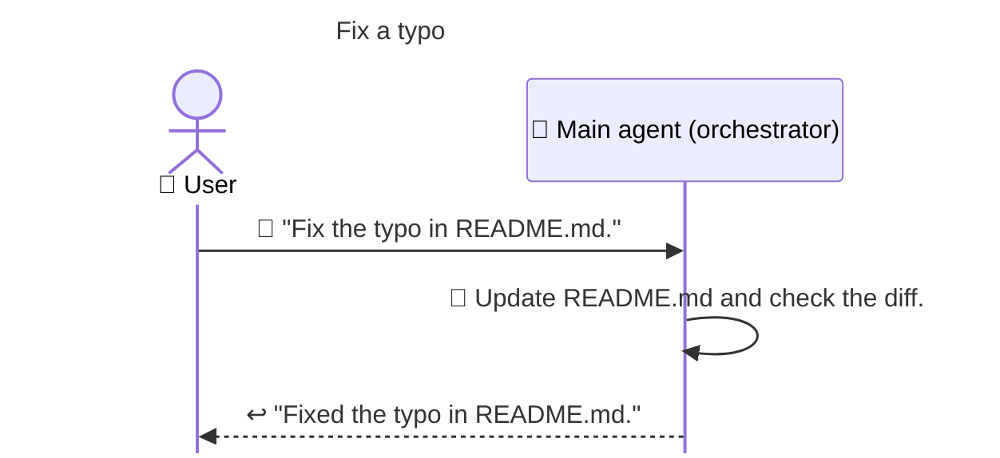
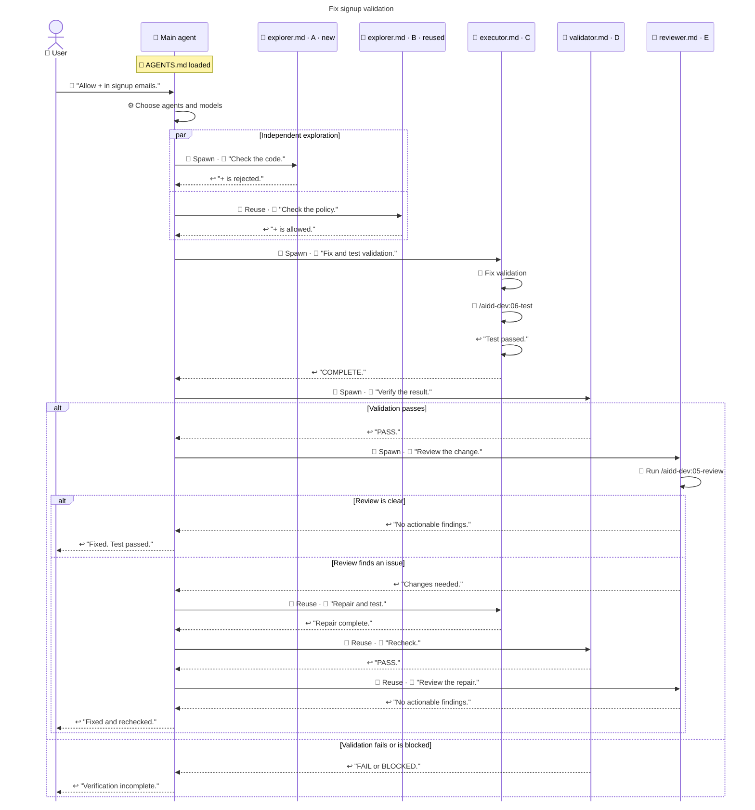

# 🤝 Subagents

Four generic agents your AI tool can hand work to, each in a fresh context. They ship with the `aidd-orchestrator` plugin; the skill that calls one gives it its concern, so the same executor writes code under `aidd-dev` and a spec under `aidd-pm`.

## 📑 Contents

- [How it works](#-how-it-works)
- [Which agent for which task](#-which-agent-for-which-task)
- [Install](#-install)
- [Models](#-models)
- [Limits](#-limits)

## 🔀 How it works

The main agent is the conversation window. It loads the host's project instructions, such as [`AGENTS.md` in Codex](https://developers.openai.com/codex/guides/agents-md), and owns the outcome. What subagents receive depends on the host and configuration.

The main agent chooses whether delegation helps. These examples and responses are hypothetical.

### A simple request

When delegation would add overhead, the main agent can handle the request itself.



### Measuring delegation

Create two worktrees at commit `de409ef5`, change the title's `Framework` to `Framwork` in each `README.md`, and set `DIRECT` and `DELEGATED` to their paths. Install the executor and use the same Codex configuration for both runs:

```sh
prompt='Correct the typo "Framwork" in the title of README.md. Verify the result and do not commit.'
time codex exec --json --sandbox workspace-write -m gpt-6.1-terra -c 'model_reasoning_effort="medium"' -c 'agents.enabled=false' -C "$DIRECT" "$prompt"
time codex exec --json --sandbox workspace-write -m gpt-6.1-terra -c 'model_reasoning_effort="medium"' -c 'agents.enabled=true' -c 'agents.default_subagent_model="gpt-6-luna"' -C "$DELEGATED" "$prompt Delegate the edit to the aidd-orchestrator-executor subagent and wait for its result; do not use a validator."
```

Check that both titles are restored and the delegated run used the requested agent and model. Compare elapsed time and the final cumulative token usage in each rollout under `~/.codex/sessions/`: add parent and executor totals once, counting the executor only after its own model context. Cached input is already included in the total. Repeat with fresh sessions and alternating order; report cache conditions and the median.

One run per approach on November 6, 2026 produced:

| Approach | Time | Total tokens | Cached input tokens |
| --- | ---: | ---: | ---: |
| Main agent alone | 17.05 s | 104,556 | 84,864 |
| Main agent + executor | 33.12 s | 351,634 | 287,872 |

The delegated total includes both agents. These single-run results are indicative, not a general benchmark. Monetary cost was unavailable.

### A request with subagents

This example shows the decisions, tool calls and possible outcomes for one request. Explorer A is new and Explorer B is reused; their independent tasks run in parallel. Every subagent returns to the main agent.



## 🧭 Which agent for which task

| Agent | Use it to | It returns | Writes files, by instruction |
| --- | --- | --- | --- |
| [Explorer](../plugins/aidd-orchestrator/agents/explorer.md) | Investigate scoped questions across code, documentation, services or the web | The answer, with sources and unknowns | No |
| [Executor](../plugins/aidd-orchestrator/agents/executor.md) | Write or fix code and docs within a defined scope, then verify them | `COMPLETE`, `INCOMPLETE` or `BLOCKED`, with changes and checks run | Yes |
| [Validator](../plugins/aidd-orchestrator/agents/validator.md) | Confirm delivered work meets the request and its acceptance criteria | `PASS`, `FAIL` or `BLOCKED`, with evidence | No; runs checks |
| [Reviewer](../plugins/aidd-orchestrator/agents/reviewer.md) | Find defects, contradictions, duplication and needless complexity in finished work | `no actionable findings`, `changes needed` or `insufficient evidence`, with findings | No; only the review report a workflow asks for |

## 📦 Install

Install the `aidd-orchestrator` plugin: `/plugin install aidd-orchestrator@aidd-framework` in Claude Code, or see the [quick start](../README.md#quick-start) for the other tools. The agents come with it, except as a Codex plugin (see [Limits](#-limits)); open a new session so the tool loads them.

## 🧠 Models

No model is pinned. Each host applies its own default for subagents, usually the model of the session that called them. A model you declare in an agent reaches every host in its own format.

## 🚧 Limits

- **Tools:** every agent inherits the calling session's tools and permissions; what it writes is an instruction, not a restriction.
- **Codex:** a Codex plugin cannot carry agents, so only the flat distribution installs them, in `.codex/agents/`. Codex loads them only in a trusted project.
- **Models:** OpenCode V1 reads the same file but not the `#<effort>` variant.
- **Updates:** reinstalling replaces the agents still shipped; one removed from the plugin stays where a copy put it until you delete it.

Sources: [Claude Code sub-agents](https://code.claude.com/docs/en/sub-agents), [Copilot custom agents](https://docs.github.com/en/copilot/reference/custom-agents-configuration), [OpenCode agents](https://opencode.ai/v2/docs/agents), [Codex subagents](https://developers.openai.com/codex/subagents), [Cursor subagents](https://cursor.com/docs/subagents).
