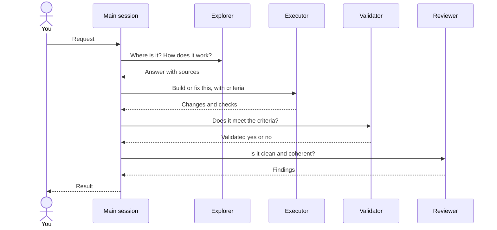

# 🤝 Subagents

Four generic agents your AI tool can hand work to, each in a fresh context. They ship with the `aidd-orchestrator` plugin; the skill that calls one gives it its concern, so the same executor writes code under `aidd-dev` and a spec under `aidd-pm`.

## 📑 Contents

- [How it works](#-how-it-works)
- [Which agent for which task](#-which-agent-for-which-task)
- [Install](#-install)
- [Read-only enforcement](#-read-only-enforcement)
- [Models](#-models)
- [Limits](#-limits)

## 🔀 How it works

Your main session keeps the conversation and decides what to delegate. Each agent gets a scoped brief, works in its own context, and returns its result to the main session, which owns the final answer.

Each step is optional: the main session calls only the agents the task needs, and repeats execution when validation or review finds a gap.

Delegation is by responsibility: workflows such as `/aidd-orchestrator:01-sdlc` ask for "a fresh validation agent", and the host picks one of these if installed, or its default subagent otherwise. No workflow names an agent, because the name changes with the install: `aidd-orchestrator:validator` from the Claude Code marketplace, `aidd-orchestrator-validator` in a project distribution.

## 🧭 Which agent for which task

| Agent | Use it to | It returns | Writes files |
| --- | --- | --- | --- |
| [Explorer](../plugins/aidd-orchestrator/agents/explorer.md) | Find files and symbols, trace a flow, answer a codebase question before a change | The answer, with sources and unknowns | No, enforced |
| [Executor](../plugins/aidd-orchestrator/agents/executor.md) | Write or fix code and docs within a defined scope, then verify them | `COMPLETE`, `INCOMPLETE` or `BLOCKED`, with changes and checks run | Yes |
| [Validator](../plugins/aidd-orchestrator/agents/validator.md) | Confirm delivered work meets the request and its acceptance criteria | `Validated: yes` or `no`, with what failed | No edits, enforced; keeps the shell to run checks |
| [Reviewer](../plugins/aidd-orchestrator/agents/reviewer.md) | Find defects, contradictions, duplication and needless complexity in finished work | `no actionable findings`, `changes needed` or `insufficient evidence`, with findings | Its review report only, by instruction |

## 📦 Install

Install the `aidd-orchestrator` plugin: `/plugin install aidd-orchestrator@aidd-framework` in Claude Code, or see the [quick start](../README.md#-quick-start) for the other tools. The agents come with it; open a new session so the tool loads them.

## 🔒 Read-only enforcement

An instruction alone stops nothing, so each read-only agent declares its tools in the frontmatter, in Claude Code syntax, and the build translates it per host:

| Host | What the build writes | Effect |
| --- | --- | --- |
| Claude Code | `tools` allowlist, unchanged | Explorer: `Read, Grep, Glob`. Validator: the same plus `Bash` |
| GitHub Copilot | `tools`, which Copilot reads through its aliases (`Read` → `read`, `Grep`/`Glob` → `search`, `Bash` → `execute`) | Same as Claude Code |
| OpenCode | A `permissions` rule denying `edit`, and no `name`, which makes OpenCode 2.1.2 ignore the rule; V2 reads no `tools`, so the allowlist is not copied | Edits denied; the shell stays open |
| Codex | Nothing: a custom agent inherits the calling session's sandbox | Instruction only |
| Cursor, Kilo | Nothing | Instruction only |

A hook cannot do this job: Claude Code ignores `hooks` in a plugin's agents.

The reviewer is not restricted: `/aidd-dev:05-review` writes its report beside the plan, so it needs file writes.

## 🧠 Models

No model is pinned. Each host applies its own default for subagents, usually the model of the session that called them. Choosing a model and an effort per provider is a separate change.

## 🚧 Limits

- **Shell:** an agent that keeps a shell can still write through it. Only the explorer is fully read-only.
- **Codex:** project agents load only for trusted projects.

Sources: [Claude Code sub-agents](https://code.claude.com/docs/en/sub-agents), [Copilot custom agents](https://docs.github.com/en/copilot/reference/custom-agents-configuration#tools), [OpenCode agents](https://opencode.ai/v2/docs/agents#permissions), [Codex subagents](https://developers.openai.com/codex/subagents), [Cursor subagents](https://cursor.com/docs/subagents).
