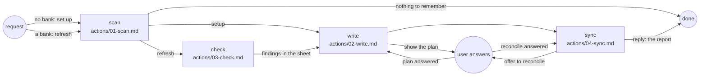

# Project Memory

## Actions

- Each box: read its action file, then follow it.

## Transversal rules

- Speak only to ask or to give the final reply; otherwise call tools.
- Send the `plan` and `report` output as it is, in plain chat text, nothing before it.
- After the plan or a reconcile offer, wait.
- Edit no memory file outside write.
- Run no version-control command: `changes` gives what changed.
