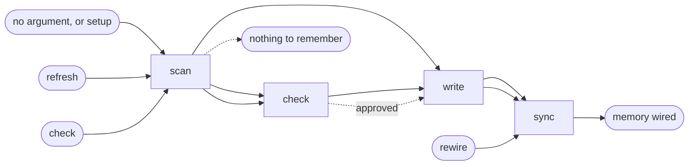

# Project Memory

## Actions

Run the flow above, reading only the next action file.

| Action | Does                            |
| ------ | ------------------------------- |
| scan   | read the project                |
| write  | write the memory                |
| check  | print what drifted |
| sync   | wire it into the tools          |

## Engine

| Command | When | Effect |
| ------- | ---- | ------ |
| `memory.cjs`, found by file name | before any call | first hit wins: the plugin's `hooks/` beside `skills/`, then `hooks/aidd-context/` under the tool's folder, then `hooks/` inside this skill |
| `node memory.cjs check . aidd_docs/memory/<file>.md` | per file | checks that file |
| `node memory.cjs check .` | whole bank | checks the whole bank |
| `node memory.cjs sync <tool>...` | picked tools known | fills each named tool's block |
| `node memory.cjs lines . > <session scratch>/lines.txt` | write, first step | records the bank's lines |
| `node memory.cjs vanished <that file> .` | write, last step | lists the lines gone |

## Transversal rules

- If a referenced file cannot be read, stop and say so. Never invent its content.
- Ask before anything ambiguous. Never default silently.
- A bank that already exists changes only through what the user approved, file by file and line by line.
- End with a short report of what changed.
