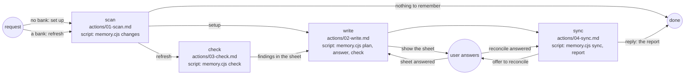

# Project Memory

## Actions

- Each box: read its action file, then follow it.

## Transversal rules

- Speak only to ask or to give the final reply; otherwise call tools.
- After the sheet or a reconcile offer, wait.
- Edit no memory file outside write.
- Run no version-control command: `changes` gives what changed.
