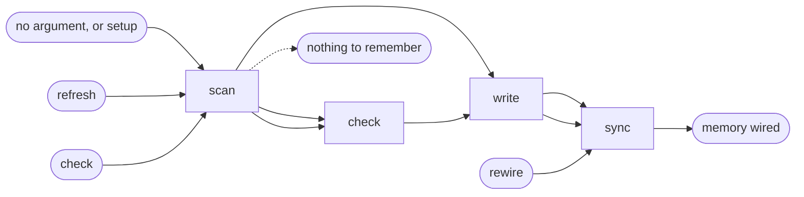

# Project Memory

The memory is the macro view an AI tool loads every session and a person reads too.

## Actions

Run the flow above, reading only the next action file.

| Action | Does                            |
| ------ | ------------------------------- |
| scan   | read the project into a fact sheet |
| write  | write the memory                |
| check  | print what drifted |
| sync   | wire it into the tools          |

## Engine

| Command | When | Effect |
| ------- | ---- | ------ |
| `memory.cjs`, found by file name | before any call | first hit wins: the plugin's `hooks/` beside `skills/`, then `hooks/aidd-context/` under the tool's folder, then `hooks/` inside this skill |
| `node memory.cjs check . aidd_docs/memory/<file>.md` | per file | checks that file |
| `node memory.cjs check .` | whole bank | checks the whole bank |
| `node memory.cjs facts <sheet> .` | write, before any write | exits 1 naming each bad sheet line |
| `node memory.cjs sync <tool>...` | picked tools known | fills each named tool's block |
| `node memory.cjs vanished . --sheet <sheet>` | write, last step | lists each line gone from the bank as committed, HEAD only, unless a `D` line quotes it |

## Transversal rules

- If a referenced file cannot be read, stop and say so. Never invent its content.
- Silence is consent: an unanswered `R` or `D` line is written, an unanswered `Q` removes its slot. A `D` starting `remove` or `replace` changes or removes an existing line and needs an answer starting with `yes`; the engine lists any other line gone. Autonomous means no person: the caller's instruction answers.
- End with a short report of what changed.
