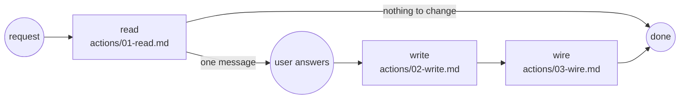

# Project Memory

## Actions

- Each box: read its action file, then follow it.

## Transversal rules

- A line already in the bank is the team's: quote it exactly and get a yes before you replace or remove it.
- Ask everything in one message, then wait; never ask twice.
- Edit no memory file outside write.
- When the skill's script exits 1, fix the call from what it prints; never do its work by hand.
- When the turn-end check lists lost lines, show them to the person exactly as given; restore one only if they ask.
- Fix each error the turn-end check gives on a line you wrote; keep a warned line the code confirms.
