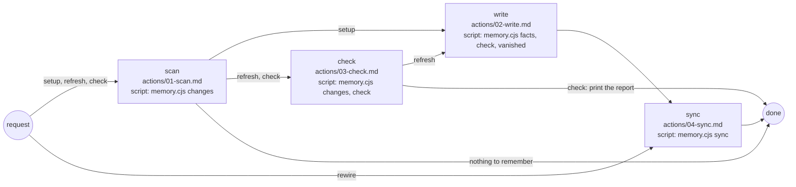

# Project Memory

## Actions

Read an action's file, then do what it says.

## Transversal rules

- Run no version-control command: `changes` gives what changed.
- End with a short report of what changed.
