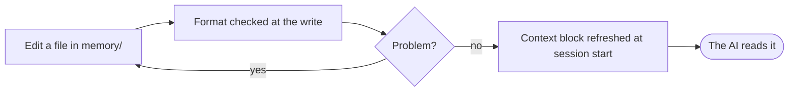

# Project AI Docs

What the AI knows about this project, what it produces, and how to change either.

## What the AI knows

| Folder | Holds | Loaded |
| --- | --- | --- |
| `memory/` | the architecture, conventions and decisions, one file per concern | every session |
| `memory/internal/` | decision records and workflow notes | when a task needs it |
| `memory/external/` | outside documentation | when you ask |
| `rules/` | coding standards | automatically |

## What it produces

| Folder | Holds |
| --- | --- |
| `tasks/` | specs, plans and reviews, one folder per piece of work |
| `backlog/` | epics, user stories, tasks, spikes and defects |
| `product/` | product briefs |
| `ui/` | the design system |
| `recipes/` | how-to sheets |

The install guide of a new project, INSTALL.md, sits at the project root.

## Change what the AI knows

The context block in each AI context file is generated. Never edit it by hand.

## Hooks

| Hook | Runs | Does |
| --- | --- | --- |
| Memory refresh | when a session starts | lists the memory files in the context block of each AI tool |
| Memory check | after a file write | reports a memory file that breaks the format rules |

## Learn more

- [Get started](https://github.com/ai-driven-dev/framework#get-started)
- [Guides](https://github.com/ai-driven-dev/framework/blob/main/docs/GUIDES.md)
- [Concepts](https://github.com/ai-driven-dev/framework/blob/main/docs/CONCEPTS.md)
