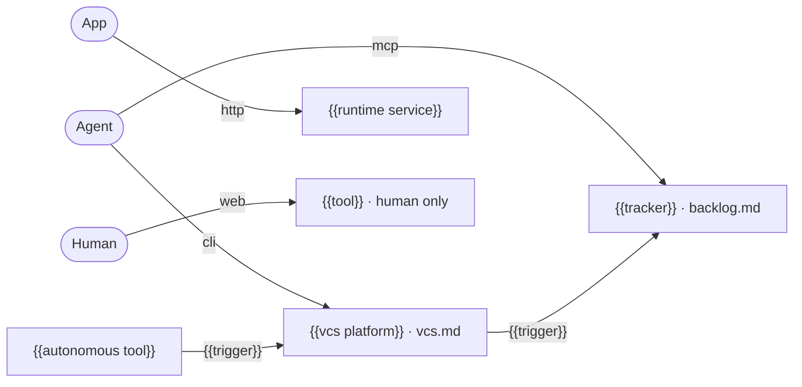

# Ecosystem

{{Which tools outside the repo does the project use? Draw one edge per actor access and per hand-off, then delete this line.}}

## Services

- {{Which external services does the project call, how does a call authenticate, retry and time out, and what happens when the service is down?}}
