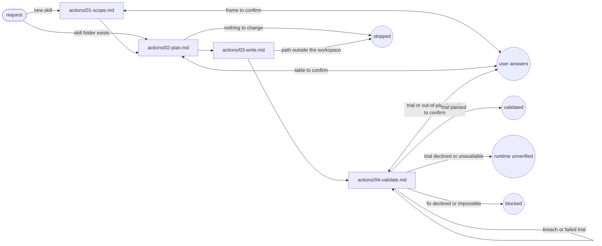

# Skill Generate

## Transversal rules

- If a cited reference cannot be read, stop and report the missing file.
- Announce intended writes before editing.
- Keep the meaning of each rule, step, branch, wait, loop and stop of an existing skill, unless the request changes it.
- Add nothing the request, the frame, the existing skill or the user did not confirm.
- Leave each file the plan does not name byte-identical.
