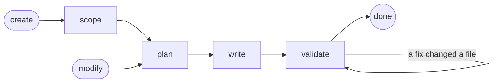

# Skill Generate

## Actions

Read an action's file, then do what it says.

| Action | File |
| ------ | ---- |
| scope | [actions/01-scope.md](actions/01-scope.md) |
| plan | [actions/02-plan.md](actions/02-plan.md) |
| write | [actions/03-write.md](actions/03-write.md) |
| validate | [actions/04-validate.md](actions/04-validate.md) |

## Transversal rules

- Default to `create`; follow `modify` when asked.
- If a cited reference cannot be read, stop and report the missing file.
- Confirm every target and name with the user.
- Never write silently.
