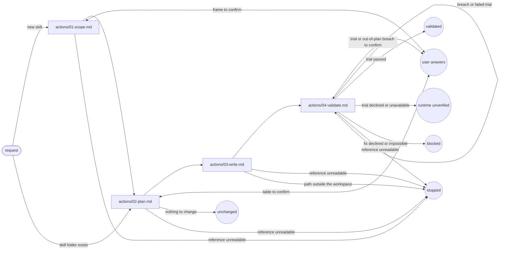

# Skill Generate

## Transversal rules

- If a cited reference cannot be read, stop and report the missing file.
- Confirm every target and name with the user.
- Announce intended writes before editing.
- Keep the meaning of each rule, step, branch, wait, loop and stop of an existing skill.
  - Changed by the request: apply the change.
  - Wording: follow the authoring rules.
- Add nothing beyond the request, the frame and the existing skill.
  - Confirmed by the user: add it.
- Leave each file the plan does not name byte-identical.
- In a subagent:
  - Propose each confirmation to the caller instead of asking.
  - Write only inside the workspace.
  - Report runtime unverified.
