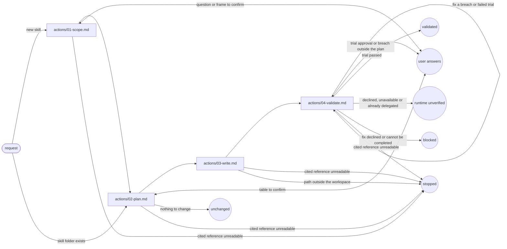

# Skill Generate

## Transversal rules

- If a cited reference cannot be read, stop and report the missing file.
- Confirm every target and name with the user.
- Announce intended writes before editing.
