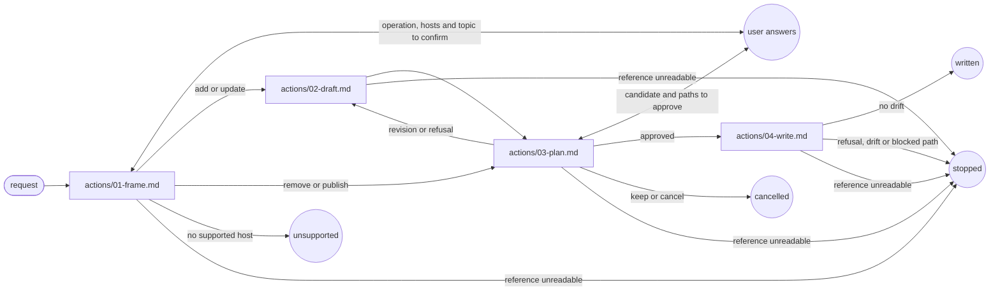

# Rule Generate

## Transversal rules

- If a cited reference cannot be read, stop and name it.
- Write only after the user approves the candidate shown last.
  - A choice, merge, edit or rename is not an approval: show the revision and wait.
- Change an existing source or publication only with permission naming it.
- Keep or cancel leaves project bytes unchanged.
