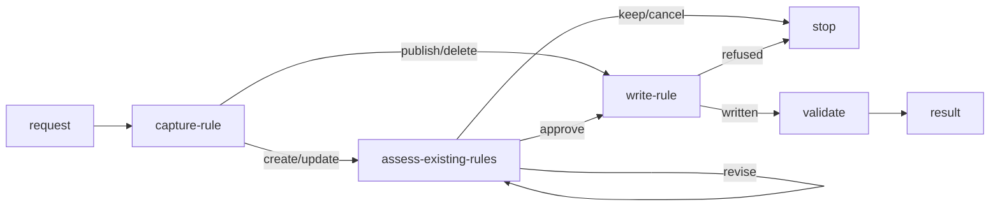

# Rule Generate

## Actions

Read each numbered action file in `actions/` before executing it.

| Action | Does |
| --- | --- |
| capture-rule | confirm intent and destinations |
| assess-existing-rules | compare policies and resolve findings |
| write-rule | publish the approved result |
| validate | check affected files |
