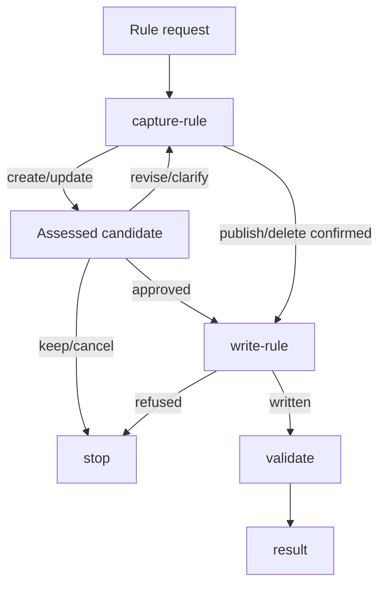

# Rule Generate

## Actions

Run the flow above. Read only the next action file and its references.

| Action | Does |
| --- | --- |
| capture-rule | frame, compare and decide |
| write-rule | publish the approved result |
| validate | check the affected files |

## Transversal rules

- **Report unsupported hosts** with alternatives; a lone AGENTS file identifies no installed host.
- **If an installed reference cannot be read**, stop and report the missing file.
- **Await approval** of the full assessed candidate, new rules included, before any rule, request or publication write; renew it when the candidate, resolution or evidence changes.
- **Change existing sources or publications** only with explicit permission naming them.
- **Keep or cancel** leaves project bytes unchanged.
